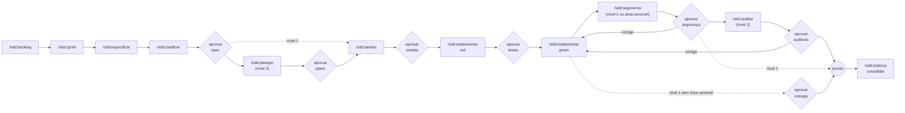
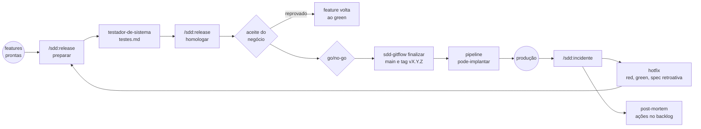

<p align="center">
  
</p>

# SDD: specs que mandam no código

Um plugin para agentes de código que faz da especificação versionada a **fonte
de verdade** do projeto. Engenharia de verdade, não *vibe coding*.

Agentes escrevem código rápido. O difícil é fazer o agente escrever o código
*certo*: o que você queria, dentro do escopo, provado por testes que ninguém
viciou e conferido por alguém que não foi quem implementou. Este plugin
organiza isso em fases curtas, cada uma terminando num **gate** em que você
aprova antes de seguir, com um rigor que acompanha o tamanho do risco.

E cobre o ciclo inteiro, não só o código: da análise (backlog, sprint, spec)
ao desenvolvimento (plano, tarefas, TDD), à revisão (segurança e auditoria), à
entrega (testes de sistema, homologação com o cliente, go/no-go, produção), ao
DevOps (um pipeline que respeita os gates) e à manutenção (incidentes, hotfix,
post-mortem e uma spec viva do sistema).

E mantém você no controle: cada aprovação fica registrada com o hash do que foi
aprovado, um quadro mostra a situação de todas as features e releases, e uma
caixa de entrada lista o que espera a sua decisão.

E usa o mesmo **Git Flow** em todo projeto: `main`, `develop`,
`feature/NNN-slug`, `release/X.Y.Z` e `hotfix/X.Y.Z`, com as branches criadas,
juntadas e marcadas com a tag `vX.Y.Z` nos momentos certos do ciclo. Nenhum
agente inventa outro nome. Ver [Git Flow](docs/referencia/git-flow.md).
As versões seguem o SemVer e são **calculadas pelos commits** (Conventional
Commits), com o `CHANGELOG.md` no formato Keep a Changelog. Ver
[versionamento](docs/referencia/versionamento.md).

É pequeno de propósito: vinte skills, seis subagents, dois hooks e treze
utilitários em bash. Tudo em markdown legível. Adapte à vontade.

> **Primeira vez?** Escolha o guia passo a passo da sua situação:
>
> | Você tem | Leia |
> |---|---|
> | um repositório novo | [começar um projeto novo](docs/referencia/projeto-novo.md) |
> | um projeto em andamento, com ou sem specs e tarefas de outros agentes | [adotar o SDD num projeto em andamento](docs/referencia/projeto-em-andamento.md) |
>
> Depois, o [guia do desenvolvedor](docs/referencia/guia-do-desenvolvedor.md)
> (o dia a dia, com os comandos de cada etapa) e o
> [ciclo de vida](docs/referencia/ciclo-de-vida.md) (o mapa do processo
> inteiro: etapas, gates, quem decide o quê e onde fica cada coisa).

## Instalação (1 minuto)

### 1. Instale o plugin

<details>
<summary><strong>Claude Code</strong></summary>

```bash
claude plugin marketplace add geraldodominguez/sdd-plugin
claude plugin install sdd@sdd-plugin
```

Para atualizar: `claude plugin marketplace update sdd-plugin` e depois
`claude plugin update sdd`.

</details>

<details>
<summary><strong>Outros agentes</strong> (atualização manual)</summary>

As skills seguem o formato padrão (`SKILL.md`). Copie a pasta `skills/` para o
diretório de skills do seu agente, ponha `bin/` no PATH e garanta que ele leia o
`AGENTS.md` do projeto. Os hooks são específicos do Claude Code. Detalhes em
[docs/referencia/portabilidade.md](docs/referencia/portabilidade.md).

</details>

No Windows, o Claude Code roda os hooks no Git Bash: instale o
[Git for Windows](https://git-scm.com/download/win).

### 2. Rode `/sdd:iniciar` no seu repositório

Uma vez por repositório. Ele:

- cria `.sdd/` (configuração, backlog, sprints, templates), `specs/`, `sistema/` e `docs/adr/`;
- lê o seu código e rascunha a **constituição**, as regras que valem para todas as features (arquitetura, testes, segurança, ambientes, operação);
- injeta as regras do SDD no `CLAUDE.md` e no `AGENTS.md`;
- num projeto que não nasceu com o plugin, lê as specs, planos, tarefas e ADRs que outros processos e agentes deixaram (em `docs/specs/`, `tasks/`, `TODO.md`, `.kiro/`, `.specify/`...) e, com a sua aprovação do mapa, os renomeia e converte para o padrão. Cada feature em andamento entra numa **transição** que mostra como era e como fica, com as tarefas feitas fora do plugin marcadas `[O]`; aprovada a transição, o plugin continua de onde o outro processo parou. Ver [projetos existentes](docs/referencia/projetos-existentes.md#projeto-com-artefatos-de-outro-processo).

Depois, revise a constituição e preencha no `.sdd/config.yml` o que o plugin não
adivinha: `areas_sensiveis` (caminhos que exigem revisão de segurança) e os
comandos de teste, varredura de segurança e deploy. Para o CI, rode
`/sdd:pipeline` uma vez.

### 3. Pronto

| Você tem | Comece por |
|---|---|
| uma mudança para fazer agora | `/sdd:especificar <a mudança que você quer>` |
| uma lista de coisas para fazer | `/sdd:backlog adicionar <ideia>` para cada uma, e `/sdd:sprint planejar` |
| features prontas para ir a produção | `/sdd:release preparar` |
| algo quebrado em produção | `/sdd:incidente abrir` |
| um sistema que já existe e quer documentar uma parte | `/sdd:sistema mapear` |
| specs e tarefas espalhadas por outros agentes | `/sdd:iniciar --adotar` |

Perdeu o fio? `/sdd:status` mostra o quadro, `/sdd:pendencias` mostra o que
espera você, e `/sdd:ajuda` diz qual comando serve para a sua situação.

## Por que este plugin existe

Ele corrige os modos de falha mais comuns de agentes de código em projetos
reais.

### #1: O agente fez o que achou que eu queria

> "Ninguém sabe exatamente o que quer."
>
> David Thomas e Andrew Hunt, *O Programador Pragmático*

**O problema.** Você pede "redefinição de senha" e o agente decide sozinho que o
link vale 24 horas, que avisa quando o e-mail não existe (abrindo uma brecha de
enumeração de usuários) e que manda SMS também. O código é plausível e não é o
que você queria, e não há nenhum documento contra o qual conferir.

**A solução** é escrever a intenção antes do código, com cada dúvida explícita:

- [`/sdd:especificar`](skills/especificar/SKILL.md) escreve o quê e o porquê em requisitos verificáveis e marca tudo que não sabe como `[PRECISA ESCLARECER]`, em vez de supor;
- [`/sdd:clarificar`](skills/clarificar/SKILL.md) transforma esses marcadores em perguntas com opções e uma recomendação.

### #2: Os testes passam, mas não provam nada

> "Testar um programa pode mostrar a presença de bugs, mas nunca a ausência deles."
>
> Edsger W. Dijkstra

**O problema.** Quando o mesmo agente escreve o código e os testes, os testes
confirmam o que ele acabou de inventar. E, quando um teste falha, a saída mais
curta é "consertar" o teste.

**A solução** é separar quem testa de quem implementa:

- [`/sdd:implementar`](skills/implementar/SKILL.md) roda o TDD em duas fases. Na **red**, o subagent `escritor-de-testes` escreve os testes só a partir dos critérios de aceitação, sem ver código. Na **green**, a sessão principal implementa, e um hook **congela os testes**: o agente não consegue editá-los para fazê-los passar.

### #3: O código e a spec se separaram em silêncio

**O problema.** A urgência muda o código e ninguém volta à spec. Em três meses
há duas verdades, e a escrita já não vale nada. Isso é o **drift**.

**A solução** é um auditor independente e uma regra simples, a de que a
divergência se resolve primeiro na spec:

- [`/sdd:auditar`](skills/auditar/SKILL.md) chama o subagent `auditor-de-drift`, que recebe só os artefatos e o diff (nenhuma justificativa), procura requisito não atendido, comportamento não pedido e teste enfraquecido, e **propõe uma delta spec** em vez de corrigir. A decisão é sua.

### #4: Processo demais para coisa pequena, ou de menos para coisa grande

**O problema.** Um processo único para tudo falha dos dois lados: ou é
burocrático e você abandona, ou é frouxo e não protege nada.

**A solução** são **níveis de rigor**:

| Nível | Quando | O que você roda |
|---|---|---|
| 0, direto | typo, formatação, refatoração coberta por testes | nada: faça direto |
| 1, leve | correção de bug, mudança localizada | especificar, tarefas, implementar |
| 2, completo | feature nova, domínio, schema, contrato, segurança | o fluxo inteiro |

O [`/sdd:especificar`](skills/especificar/SKILL.md) classifica e pede a sua
confirmação. Regra de ouro: mudou comportamento observável, nível 1 no mínimo.

### #5: A janela de contexto vira um depósito

**O problema.** Especificar, desenhar o banco, testar e auditar na mesma sessão
enche a janela de detalhes que a fase seguinte não precisa, e contamina cada
etapa com as premissas da anterior.

**A solução** são **subagents com contexto próprio**, cada um com um papel:

| Subagent | Fase | Por que isolado |
|---|---|---|
| `mapeador-de-contexto` | especificação | varre o código e devolve só o mapa do que a mudança toca |
| `arquiteto-de-contratos` | plano | desenha as fronteiras sem a pressa de implementar |
| `escritor-de-testes` | red | não vê código nem a intenção de quem vai implementar |
| `revisor-de-seguranca` | segurança | olha a mudança como atacante, sem a confiança de quem a escreveu |
| `auditor-de-drift` | auditoria | não recebe justificativas e não corrige nada |
| `testador-de-sistema` | release | testa o sistema inteiro, não a feature, sem mexer em código de produção |

### #6: Não sei o que está acontecendo

**O problema.** Com o agente trabalhando em várias features, você perde a
visão do conjunto: o que está em andamento, o que está parado esperando você, o
que ficou para depois. A aprovação de cada fase fica perdida na conversa, e
ninguém consegue provar depois o que foi aprovado e quando.

**A solução** são comandos de acompanhamento e aprovações registradas:

- [`/sdd:aprovar`](skills/aprovar/SKILL.md) é o gate formal: registra quem aprovou, quando, e o **hash** do que foi aprovado. Se o artefato muda depois, os comandos seguintes param e o auditor acusa;
- [`/sdd:status`](skills/status/SKILL.md) mostra o **quadro**: sprint, features por coluna, topo do backlog e quanto espera você;
- [`/sdd:pendencias`](skills/pendencias/SKILL.md) é a sua caixa de entrada; [`/sdd:retomar`](skills/retomar/SKILL.md) conta o que aconteceu enquanto você estava fora;
- [`/sdd:backlog`](skills/backlog/SKILL.md) guarda o que é para depois, e [`/sdd:sprint`](skills/sprint/SKILL.md) organiza o que é para agora.

A rotina recomendada está no [guia de acompanhamento](docs/referencia/acompanhamento.md).

### #7: Passou nos testes, mas abriu uma brecha

> "Segurança é um processo, não um produto."
>
> Bruce Schneier

**O problema.** O agente implementa o que a spec pede e os testes passam, mas o
token é comparado de um jeito vulnerável, um segredo vai parar no código, o
e-mail do cliente aparece no log. Ninguém olhou a mudança como atacante, porque
os testes só provam o que a spec descreve.

**A solução** é uma revisão de segurança independente, obrigatória quando o
risco existe:

- [`/sdd:seguranca`](skills/seguranca/SKILL.md) chama o subagent `revisor-de-seguranca`, que modela as ameaças da mudança, roda as varreduras (dependências, segredos, análise estática) e confere a LGPD. Você decide: corrigir, aceitar o risco por escrito, ou aprovar. É obrigatória no nível 2 e em qualquer feature que toque uma **área sensível** (`areas_sensiveis` no config), que o plugin detecta sozinho no fim do green.

### #8: Pronto no meu computador não é em produção

**O problema.** A feature passou por todos os gates, mas ninguém testou o
sistema inteiro com ela, o cliente nunca viu funcionando, o deploy foi feito
numa sexta sem plano de volta, e o pipeline implanta qualquer tag que alguém
crie.

**A solução** é um ciclo de **release** separado do ciclo da feature, com
gates humanos próprios e um pipeline que os respeita:

- [`/sdd:release`](skills/release/SKILL.md) agrupa features prontas numa versão, chama o subagent `testador-de-sistema` (regressão, ponta a ponta, medição dos requisitos não funcionais), gera um roteiro de **homologação** em linguagem de negócio, registra o **aceite** de quem homologou, conduz o **go/no-go** com plano de implantação e rollback, e encerra com as notas de versão;
- [`/sdd:pipeline`](skills/pipeline/SKILL.md) gera ou confere o CI/CD: lint, testes, `sdd-verificar` (rastreabilidade e aprovações em dia), varreduras de segurança, deploy em homologação, e deploy em produção **só se** `sdd-release pode-implantar` confirmar o go.

### #9: Ninguém sabe o que o sistema faz hoje

**O problema.** Cada feature tem a sua spec, mas a resposta para "como funciona
a autenticação agora?" está espalhada em vinte pastas, algumas já contrariadas
por features mais novas. E, quando algo quebra em produção, a correção urgente
pula todo o processo e some sem registro.

**A solução** é uma spec viva e uma trilha de manutenção:

- [`/sdd:sistema`](skills/sistema/SKILL.md) mantém `sistema/<capacidade>.md`, o comportamento **vigente** de cada capacidade, com cada item ligado à feature e ao requisito que o originou. Toda feature pronta é **consolidada** nela, e toda spec nova parte dela;
- [`/sdd:incidente`](skills/incidente/SKILL.md) registra o incidente com severidade, cuida da mitigação, abre o **hotfix** (teste de regressão primeiro, spec retroativa aprovada antes de entregar) e conduz o **post-mortem** sem culpados, com as ações virando itens de backlog.

### Resumo

Os fundamentos de engenharia importam mais do que nunca quando quem digita é um
agente. Este plugin condensa os principais (intenção escrita antes do código,
teste independente, decisão registrada, revisão e auditoria independentes,
entrega com aceite e plano de volta, e acompanhamento visível) em passos curtos
e repetíveis.

## O fluxo

O processo tem dois ciclos encadeados. O **ciclo da feature** leva um pedido até
`pronta`: o comportamento está especificado, implementado, testado, revisado e
consolidado na spec do sistema. O **ciclo da release** leva features prontas até
a produção. A manutenção volta ao começo: um incidente vira um hotfix, que é uma
feature curta.

### O ciclo da feature



### O ciclo da release e a manutenção



Cada losango é um gate: o agente apresenta o artefato e para, e só você avança,
com o `/sdd:aprovar` (no ciclo da feature) ou com o `/sdd:release` (aceite e
go). O `/sdd:status`, o `/sdd:pendencias` e o `/sdd:retomar` acompanham tudo
isso de fora.

### Quem decide o quê

| Decisão | Quem | Onde fica registrada |
|---|---|---|
| O que entra e em que ordem | dono do produto | `.sdd/backlog.md`, `.sdd/sprints/` |
| O que a feature faz (spec) | dono do produto, com o dev | `historico.md` da feature, com hash |
| Como a feature é feita (plano, tarefas, testes) | dev ou tech lead | idem |
| Aceitar um risco de segurança | tech lead ou responsável por segurança | `seguranca.md` e `historico.md` |
| Aceitar um desvio da spec | tech lead | `auditoria.md`, `delta-spec.md`, `historico.md` |
| A release funciona para o negócio (aceite) | quem homologa (cliente, dono do produto) | `releases/<versão>/historico.md` |
| Ir para produção (go) | quem responde pela produção | idem |
| Causa e ações de um incidente | o time, sem culpados | `incidentes/INC-NNN.md` |

Um passo a passo com uma feature real, do pedido ao incidente, está em
[docs/referencia/passo-a-passo.md](docs/referencia/passo-a-passo.md), e os
artefatos que ela produz estão em [exemplos/](exemplos/).

## Como usar no dia a dia

| Quando | Comando |
|---|---|
| Ao começar o dia | `/sdd:status` e `/sdd:pendencias` |
| Surgiu uma ideia ou pedido | `/sdd:backlog adicionar` |
| Começo da sprint | `/sdd:sprint planejar`, depois `/sdd:especificar B-NNN` para cada item |
| Trabalhando numa feature | o comando que o `/sdd:status` recomenda; no fim de cada fase, `/sdd:aprovar` |
| Voltando a uma feature | `/sdd:retomar` |
| A feature ficou pronta | o `/sdd:aprovar` consolida na spec do sistema e integra em `develop` (`/sdd:sistema consolidar` só para uma pendente) |
| Hora de entregar | `/sdd:release preparar`, `homologar`, `aceitar`, `implantar`, `concluir` |
| Quebrou em produção | `/sdd:incidente abrir`, `mitigar`, `hotfix`, `resolver`, `post-mortem` |
| Fim da sprint | `/sdd:sprint encerrar` |
| Não sei o que fazer | `/sdd:ajuda` |

A rotina completa, com o que olhar em cada aprovação, está no
[guia de acompanhamento](docs/referencia/acompanhamento.md).

## Referência

As skills se dividem por **quem pode invocar**. As **invocadas pelo usuário**
só rodam quando você digita o comando, e por isso cada uma é um gate. As
**invocadas pelo modelo** podem ser chamadas por você ou pelo agente, quando a
tarefa pede, e guardam a disciplina reutilizável. Uma skill do usuário pode
chamar skills do modelo, nunca outra skill do usuário.

### Invocadas pelo usuário: acompanhamento

- **[ajuda](skills/ajuda/SKILL.md)**: Qual comando ou fluxo serve para a sua situação. Um roteador sobre os comandos do plugin.
- **[status](skills/status/SKILL.md)**: O quadro do projeto: sprint, features por coluna, backlog e o que espera você, com o próximo comando.
- **[pendencias](skills/pendencias/SKILL.md)**: A caixa de entrada: incidentes, releases, aprovações (inclusive transições), dúvidas, ADRs, delta specs, backlog a triar, itens da sprint sem spec, artefatos fora do padrão e problemas de Git Flow.
- **[retomar](skills/retomar/SKILL.md)**: O que aconteceu numa feature desde a última vez e qual é o próximo passo.
- **[backlog](skills/backlog/SKILL.md)**: Ideias e pedidos ainda sem spec: listar, adicionar, priorizar, descartar.
- **[sprint](skills/sprint/SKILL.md)**: Planejar, acompanhar e encerrar sprints.

### Invocadas pelo usuário: fluxo da feature

- **[iniciar](skills/iniciar/SKILL.md)**: Prepara o repositório: estrutura `.sdd/`, constituição rascunhada a partir do código e regras no `CLAUDE.md` e no `AGENTS.md`. Uma vez por repositório.
- **[especificar](skills/especificar/SKILL.md)**: Abre uma feature, a partir de um pedido ou de um item do backlog, e escreve a spec (o quê e por quê), classificando o nível de rigor e marcando o que precisa ser esclarecido.
- **[clarificar](skills/clarificar/SKILL.md)**: Perguntas com opções e uma recomendação sobre as ambiguidades da spec, incorporadas antes de qualquer decisão técnica.
- **[planejar](skills/planejar/SKILL.md)**: Plano técnico e contratos da feature (nível 2), num subagent isolado, checados contra a constituição.
- **[tarefas](skills/tarefas/SKILL.md)**: Quebra a feature em tarefas pequenas e rastreáveis até os requisitos e critérios.
- **[aprovar](skills/aprovar/SKILL.md)**: O gate formal: registra a aprovação de cada fase, com autor, data e hash do artefato, e avança a feature.
- **[implementar](skills/implementar/SKILL.md)**: TDD em duas fases: testes escritos por um subagent que não vê código, implementação com os testes congelados.
- **[seguranca](skills/seguranca/SKILL.md)**: Revisão de segurança independente: ameaças, varreduras e LGPD, num subagent com contexto limpo. Você decide entre aprovar, aceitar o risco ou corrigir.
- **[auditar](skills/auditar/SKILL.md)**: Auditoria independente do diff contra a spec, os contratos e a constituição, com delta spec proposta.
- **[sistema](skills/sistema/SKILL.md)**: A spec viva do sistema, por capacidade: o que o sistema faz hoje, a consolidação das features prontas e o mapeamento de projetos existentes.

### Invocadas pelo usuário: entrega e operação

- **[release](skills/release/SKILL.md)**: Das features prontas à produção: versão, testes de sistema, homologação, aceite, go/no-go com rollback, implantação e notas de versão.
- **[incidente](skills/incidente/SKILL.md)**: Incidentes em produção: severidade, mitigação, hotfix com spec retroativa e post-mortem sem culpados.
- **[pipeline](skills/pipeline/SKILL.md)**: Gera ou confere o CI/CD (GitHub Actions ou GitLab CI) com a verificação do processo e o deploy de produção condicionado ao go.

### Invocadas pelo modelo

- **[metodologia](skills/metodologia/SKILL.md)**: A disciplina do SDD: fases, níveis, rastreabilidade e como escrever specs (EARS), critérios de aceitação, planos e tarefas. O agente carrega sozinho em qualquer projeto com `.sdd/`.

### Subagents

- **[mapeador-de-contexto](agents/mapeador-de-contexto.md)**: Mapeia, só lendo, o código que a mudança vai tocar.
- **[arquiteto-de-contratos](agents/arquiteto-de-contratos.md)**: Plano e contratos estritos, sem regra de negócio.
- **[escritor-de-testes](agents/escritor-de-testes.md)**: Testes a partir dos critérios de aceitação, antes do código.
- **[revisor-de-seguranca](agents/revisor-de-seguranca.md)**: Modela ameaças, roda varreduras e confere a LGPD, sem corrigir.
- **[auditor-de-drift](agents/auditor-de-drift.md)**: Compara o diff com a spec e propõe delta spec, sem corrigir.
- **[testador-de-sistema](agents/testador-de-sistema.md)**: Regressão, ponta a ponta e medição dos RNFs de uma release, sem alterar código de produção.

### Hooks e utilitários

- **[Proteção por hooks](docs/referencia/protecao-por-hooks.md)**: o que é bloqueado em cada fase, nos modos `desligada`, `leve` e `estrita`, os artefatos novos fora do lugar do padrão, e o que o `guarda-commits` confere nos commits (Git Flow e Conventional Commits).
- **[Utilitários](docs/referencia/utilitarios.md)**: `sdd-iniciar`, `sdd-estado`, `sdd-sistema`, `sdd-release`, `sdd-incidente`, `sdd-backlog`, `sdd-sprint`, `sdd-status`, `sdd-pendencias`, `sdd-rastrear`, `sdd-verificar`, `sdd-adotar` e `sdd-gitflow`, as transições de fase e onde o estado e o histórico moram.

### Guias

- [Começar um projeto novo, passo a passo](docs/referencia/projeto-novo.md)
- [Adotar o SDD num projeto em andamento, passo a passo](docs/referencia/projeto-em-andamento.md)
- [Git Flow: as branches de cada momento do ciclo](docs/referencia/git-flow.md)
- [Versionamento: SemVer, Conventional Commits e o CHANGELOG](docs/referencia/versionamento.md)
- [Guia do desenvolvedor: do zero ao primeiro deploy](docs/referencia/guia-do-desenvolvedor.md)
- [Ciclo de vida: o processo inteiro, etapa por etapa](docs/referencia/ciclo-de-vida.md)
- [Guia de acompanhamento: a rotina do humano](docs/referencia/acompanhamento.md)
- [Passo a passo: do pedido à produção e ao incidente](docs/referencia/passo-a-passo.md)
- [Níveis de rigor](docs/referencia/niveis-de-rigor.md)
- [Projetos existentes](docs/referencia/projetos-existentes.md)
- [Portabilidade para outros agentes](docs/referencia/portabilidade.md)
- [Glossário](GLOSSARIO.md)

Cada skill tem também uma página de documentação em [docs/](docs/), com o que
faz, quando usar, perguntas frequentes e como saber que está funcionando.

## Onde fica cada coisa no seu projeto

```
.sdd/                    configuração, constituição, backlog, sprints, templates
specs/NNN-slug/          uma feature: spec, plano, contratos, tarefas, segurança, auditoria, estado, histórico
sistema/<capacidade>.md  o que o sistema faz hoje (spec viva)
releases/<versão>/       uma release: testes, homologação, implantação, notas, estado, histórico
incidentes/INC-NNN.md    um incidente, com linha do tempo e post-mortem
docs/adr/NNNN-slug.md    decisões de arquitetura
docs/arquitetura/        documentos e diagramas de arquitetura, como referência
docs/legado/             o que veio de outro processo e não entra no fluxo
```

E as branches, sempre com estes nomes:

```
main                     produção; só recebe merge de release/ e hotfix/, com a tag vX.Y.Z
develop                  integração; recebe as features prontas
feature/NNN-slug         uma por feature, com o id da pasta em specs/
release/X.Y.Z            uma por release, de develop para main
hotfix/X.Y.Z             uma por hotfix, de main para main e develop
```

Tudo é markdown ou texto, versionado no git, legível sem o plugin. Esse layout
é um contrato: o hook bloqueia criar um artefato fora dele, para que cada
agente não invente a própria estrutura, e o `/sdd:iniciar --adotar` traz de
volta o que escapou.

## Licença

[MIT](LICENSE). Contribuições: leia o [ESCOPO.md](ESCOPO.md) e o
[CONTRIBUINDO.md](CONTRIBUINDO.md).
