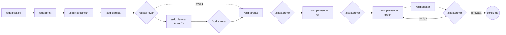

<p align="center">
  
</p>

# SDD: specs que mandam no código

Um plugin para agentes de código que faz da especificação versionada a **fonte
de verdade** do projeto. Engenharia de verdade, não *vibe coding*.

Agentes escrevem código rápido. O difícil é fazer o agente escrever o código
*certo*: o que você queria, dentro do escopo, provado por testes que ninguém
viciou e conferido por alguém que não foi quem implementou. Este plugin
organiza isso em fases curtas, cada uma terminando num **gate** em que você
aprova antes de seguir, com um rigor que acompanha o tamanho do risco.

E mantém você no controle: cada aprovação fica registrada, um quadro mostra a
situação de todas as features, e um backlog e sprints organizam o que vem
depois.

É pequeno de propósito: quinze skills, quatro subagents, dois hooks e sete
utilitários em bash. Tudo em markdown legível. Adapte à vontade.

## Instalação (1 minuto)

### 1. Instale o plugin

<details>
<summary><strong>Claude Code</strong></summary>

```bash
claude plugin marketplace add geraldodominguez/sdd-plugin
claude plugin install sdd@sdd-plugin
```

Para atualizar: `claude plugin marketplace update sdd-plugin` e depois
`claude plugin update sdd`.

</details>

<details>
<summary><strong>Outros agentes</strong> (atualização manual)</summary>

As skills seguem o formato padrão (`SKILL.md`). Copie a pasta `skills/` para o
diretório de skills do seu agente, ponha `bin/` no PATH e garanta que ele leia o
`AGENTS.md` do projeto. Os hooks são específicos do Claude Code. Detalhes em
[docs/referencia/portabilidade.md](docs/referencia/portabilidade.md).

</details>

No Windows, o Claude Code roda os hooks no Git Bash: instale o
[Git for Windows](https://git-scm.com/download/win).

### 2. Rode `/sdd:iniciar` no seu repositório

Uma vez por repositório. Ele:

- cria `.sdd/` (configuração, backlog, sprints, templates), `specs/` e `docs/adr/`;
- lê o seu código e rascunha a **constituição**, as regras que valem para todas as features;
- injeta as regras do SDD no `CLAUDE.md` e no `AGENTS.md`.

### 3. Pronto

| Você tem | Comece por |
|---|---|
| uma mudança para fazer agora | `/sdd:especificar <a mudança que você quer>` |
| uma lista de coisas para fazer | `/sdd:backlog adicionar <ideia>` para cada uma, e `/sdd:sprint planejar` |

Perdeu o fio? `/sdd:status` mostra o quadro, `/sdd:pendencias` mostra o que
espera você, e `/sdd:ajuda` diz qual comando serve para a sua situação.

## Por que este plugin existe

Ele corrige os modos de falha mais comuns de agentes de código em projetos
reais.

### #1: O agente fez o que achou que eu queria

> "Ninguém sabe exatamente o que quer."
>
> David Thomas e Andrew Hunt, *O Programador Pragmático*

**O problema.** Você pede "redefinição de senha" e o agente decide sozinho que o
link vale 24 horas, que avisa quando o e-mail não existe (abrindo uma brecha de
enumeração de usuários) e que manda SMS também. O código é plausível e não é o
que você queria, e não há nenhum documento contra o qual conferir.

**A solução** é escrever a intenção antes do código, com cada dúvida explícita:

- [`/sdd:especificar`](skills/especificar/SKILL.md) escreve o quê e o porquê em requisitos verificáveis e marca tudo que não sabe como `[PRECISA ESCLARECER]`, em vez de supor;
- [`/sdd:clarificar`](skills/clarificar/SKILL.md) transforma esses marcadores em perguntas com opções e uma recomendação.

### #2: Os testes passam, mas não provam nada

> "Testar um programa pode mostrar a presença de bugs, mas nunca a ausência deles."
>
> Edsger W. Dijkstra

**O problema.** Quando o mesmo agente escreve o código e os testes, os testes
confirmam o que ele acabou de inventar. E, quando um teste falha, a saída mais
curta é "consertar" o teste.

**A solução** é separar quem testa de quem implementa:

- [`/sdd:implementar`](skills/implementar/SKILL.md) roda o TDD em duas fases. Na **red**, o subagent `escritor-de-testes` escreve os testes só a partir dos critérios de aceitação, sem ver código. Na **green**, a sessão principal implementa, e um hook **congela os testes**: o agente não consegue editá-los para fazê-los passar.

### #3: O código e a spec se separaram em silêncio

**O problema.** A urgência muda o código e ninguém volta à spec. Em três meses
há duas verdades, e a escrita já não vale nada. Isso é o **drift**.

**A solução** é um auditor independente e uma regra simples, a de que a
divergência se resolve primeiro na spec:

- [`/sdd:auditar`](skills/auditar/SKILL.md) chama o subagent `auditor-de-drift`, que recebe só os artefatos e o diff (nenhuma justificativa), procura requisito não atendido, comportamento não pedido e teste enfraquecido, e **propõe uma delta spec** em vez de corrigir. A decisão é sua.

### #4: Processo demais para coisa pequena, ou de menos para coisa grande

**O problema.** Um processo único para tudo falha dos dois lados: ou é
burocrático e você abandona, ou é frouxo e não protege nada.

**A solução** são **níveis de rigor**:

| Nível | Quando | O que você roda |
|---|---|---|
| 0, direto | typo, formatação, refatoração coberta por testes | nada: faça direto |
| 1, leve | correção de bug, mudança localizada | especificar, tarefas, implementar |
| 2, completo | feature nova, domínio, schema, contrato, segurança | o fluxo inteiro |

O [`/sdd:especificar`](skills/especificar/SKILL.md) classifica e pede a sua
confirmação. Regra de ouro: mudou comportamento observável, nível 1 no mínimo.

### #5: A janela de contexto vira um depósito

**O problema.** Especificar, desenhar o banco, testar e auditar na mesma sessão
enche a janela de detalhes que a fase seguinte não precisa, e contamina cada
etapa com as premissas da anterior.

**A solução** são **subagents com contexto próprio**, cada um com um papel:

| Subagent | Fase | Por que isolado |
|---|---|---|
| `mapeador-de-contexto` | especificação | varre o código e devolve só o mapa do que a mudança toca |
| `arquiteto-de-contratos` | plano | desenha as fronteiras sem a pressa de implementar |
| `escritor-de-testes` | red | não vê código nem a intenção de quem vai implementar |
| `auditor-de-drift` | auditoria | não recebe justificativas e não corrige nada |

### #6: Não sei o que está acontecendo

**O problema.** Com o agente trabalhando em várias features, você perde a
visão do conjunto: o que está em andamento, o que está parado esperando você, o
que ficou para depois. A aprovação de cada fase fica perdida na conversa, e
ninguém consegue provar depois o que foi aprovado e quando.

**A solução** são comandos de acompanhamento e aprovações registradas:

- [`/sdd:aprovar`](skills/aprovar/SKILL.md) é o gate formal: registra quem aprovou, quando, e o **hash** do que foi aprovado. Se o artefato muda depois, os comandos seguintes param e o auditor acusa;
- [`/sdd:status`](skills/status/SKILL.md) mostra o **quadro**: sprint, features por coluna, topo do backlog e quanto espera você;
- [`/sdd:pendencias`](skills/pendencias/SKILL.md) é a sua caixa de entrada; [`/sdd:retomar`](skills/retomar/SKILL.md) conta o que aconteceu enquanto você estava fora;
- [`/sdd:backlog`](skills/backlog/SKILL.md) guarda o que é para depois, e [`/sdd:sprint`](skills/sprint/SKILL.md) organiza o que é para agora.

A rotina recomendada está no [guia de acompanhamento](docs/referencia/acompanhamento.md).

### Resumo

Os fundamentos de engenharia importam mais do que nunca quando quem digita é um
agente. Este plugin condensa cinco deles (intenção escrita antes do código,
teste independente, decisão registrada, auditoria independente e acompanhamento
visível) em passos curtos e repetíveis.

## O fluxo



Cada losango é um gate: o agente apresenta o artefato e para, e só o
`/sdd:aprovar`, digitado por você, registra a aprovação e avança. O
`/sdd:status`, o `/sdd:pendencias` e o `/sdd:retomar` acompanham tudo isso de
fora. Um passo a passo com
uma feature real está em
[docs/referencia/passo-a-passo.md](docs/referencia/passo-a-passo.md), e os
artefatos que ela produz estão em [exemplos/](exemplos/).

## Referência

As skills se dividem por **quem pode invocar**. As **invocadas pelo usuário**
só rodam quando você digita o comando, e por isso cada uma é um gate. As
**invocadas pelo modelo** podem ser chamadas por você ou pelo agente, quando a
tarefa pede, e guardam a disciplina reutilizável. Uma skill do usuário pode
chamar skills do modelo, nunca outra skill do usuário.

### Invocadas pelo usuário: acompanhamento

- **[ajuda](skills/ajuda/SKILL.md)**: Qual comando ou fluxo serve para a sua situação. Um roteador sobre os comandos do plugin.
- **[status](skills/status/SKILL.md)**: O quadro do projeto: sprint, features por coluna, backlog e o que espera você, com o próximo comando.
- **[pendencias](skills/pendencias/SKILL.md)**: A caixa de entrada: aprovações, dúvidas, ADRs, delta specs, backlog a triar e itens da sprint sem spec.
- **[retomar](skills/retomar/SKILL.md)**: O que aconteceu numa feature desde a última vez e qual é o próximo passo.
- **[backlog](skills/backlog/SKILL.md)**: Ideias e pedidos ainda sem spec: listar, adicionar, priorizar, descartar.
- **[sprint](skills/sprint/SKILL.md)**: Planejar, acompanhar e encerrar sprints.

### Invocadas pelo usuário: fluxo

- **[iniciar](skills/iniciar/SKILL.md)**: Prepara o repositório: estrutura `.sdd/`, constituição rascunhada a partir do código e regras no `CLAUDE.md` e no `AGENTS.md`. Uma vez por repositório.
- **[especificar](skills/especificar/SKILL.md)**: Abre uma feature, a partir de um pedido ou de um item do backlog, e escreve a spec (o quê e por quê), classificando o nível de rigor e marcando o que precisa ser esclarecido.
- **[clarificar](skills/clarificar/SKILL.md)**: Perguntas com opções e uma recomendação sobre as ambiguidades da spec, incorporadas antes de qualquer decisão técnica.
- **[planejar](skills/planejar/SKILL.md)**: Plano técnico e contratos da feature (nível 2), num subagent isolado, checados contra a constituição.
- **[tarefas](skills/tarefas/SKILL.md)**: Quebra a feature em tarefas pequenas e rastreáveis até os requisitos e critérios.
- **[aprovar](skills/aprovar/SKILL.md)**: O gate formal: registra a aprovação de cada fase, com autor, data e hash do artefato, e avança a feature.
- **[implementar](skills/implementar/SKILL.md)**: TDD em duas fases: testes escritos por um subagent que não vê código, implementação com os testes congelados.
- **[auditar](skills/auditar/SKILL.md)**: Auditoria independente do diff contra a spec, os contratos e a constituição, com delta spec proposta.

### Invocadas pelo modelo

- **[metodologia](skills/metodologia/SKILL.md)**: A disciplina do SDD: fases, níveis, rastreabilidade e como escrever specs (EARS), critérios de aceitação, planos e tarefas. O agente carrega sozinho em qualquer projeto com `.sdd/`.

### Subagents

- **[mapeador-de-contexto](agents/mapeador-de-contexto.md)**: Mapeia, só lendo, o código que a mudança vai tocar.
- **[arquiteto-de-contratos](agents/arquiteto-de-contratos.md)**: Plano e contratos estritos, sem regra de negócio.
- **[escritor-de-testes](agents/escritor-de-testes.md)**: Testes a partir dos critérios de aceitação, antes do código.
- **[auditor-de-drift](agents/auditor-de-drift.md)**: Compara o diff com a spec e propõe delta spec, sem corrigir.

### Hooks e utilitários

- **[Proteção por hooks](docs/referencia/protecao-por-hooks.md)**: o que é bloqueado em cada fase, nos modos `desligada`, `leve` e `estrita`.
- **[Utilitários](docs/referencia/utilitarios.md)**: `sdd-iniciar`, `sdd-estado`, `sdd-backlog`, `sdd-sprint`, `sdd-status`, `sdd-pendencias` e `sdd-rastrear`, e onde o estado e o histórico moram.

### Guias

- [Guia de acompanhamento: a rotina do humano](docs/referencia/acompanhamento.md)
- [Passo a passo: do pedido à entrega](docs/referencia/passo-a-passo.md)
- [Níveis de rigor](docs/referencia/niveis-de-rigor.md)
- [Projetos existentes](docs/referencia/projetos-existentes.md)
- [Portabilidade para outros agentes](docs/referencia/portabilidade.md)
- [Glossário](GLOSSARIO.md)

Cada skill tem também uma página de documentação em [docs/](docs/), com o que
faz, quando usar, perguntas frequentes e como saber que está funcionando.

## Licença

[MIT](LICENSE). Contribuições: leia o [ESCOPO.md](ESCOPO.md) e o
[CONTRIBUINDO.md](CONTRIBUINDO.md).
