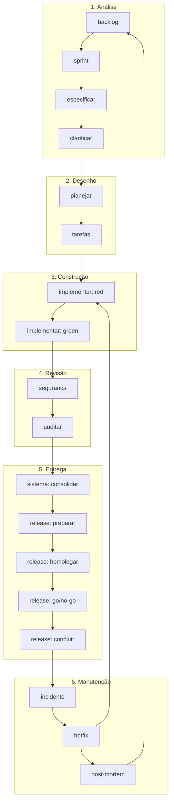
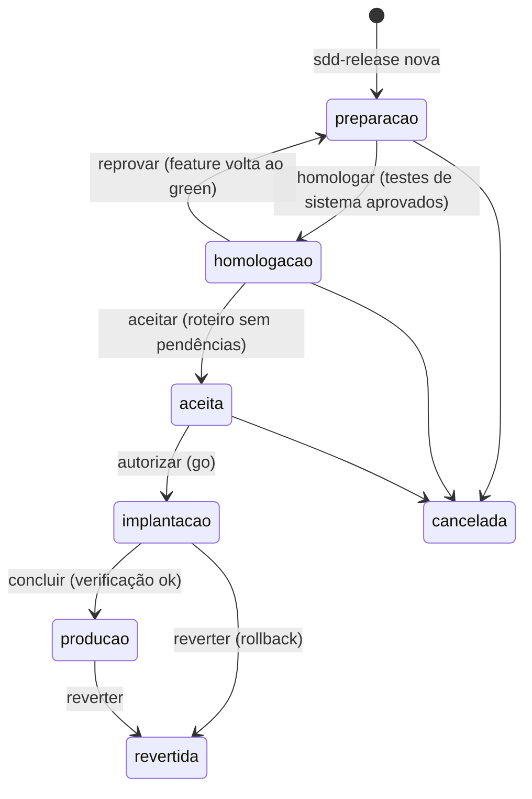
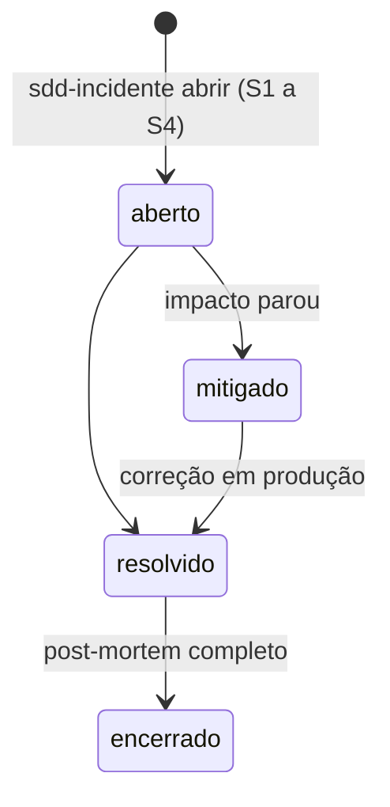
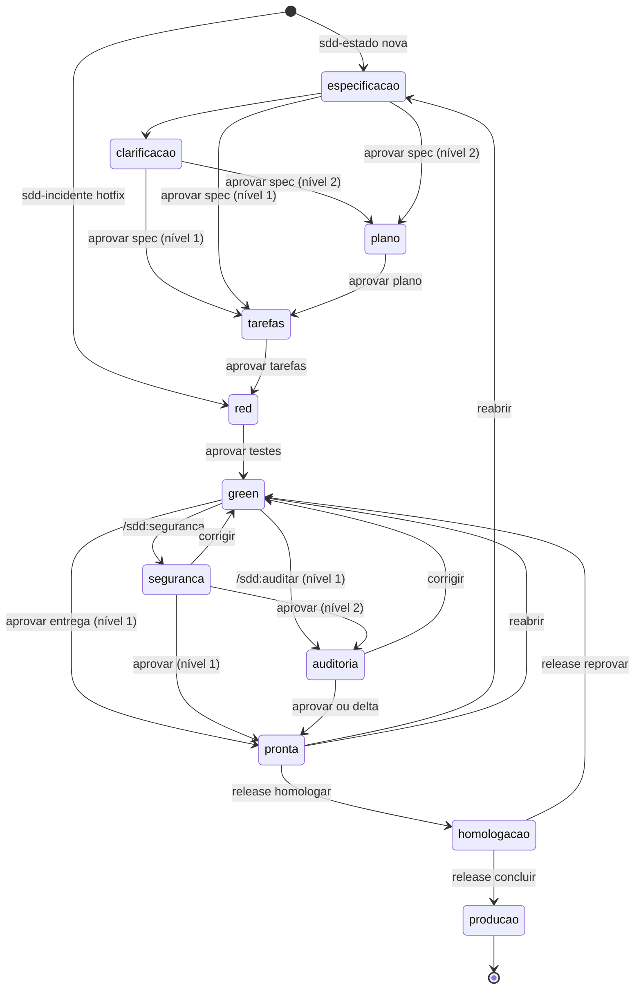

# Ciclo de vida: da análise à manutenção

Este documento descreve o processo inteiro que o plugin conduz: cada etapa, o
que entra e o que sai dela, quem decide, qual comando usar e como saber que
terminou. É a referência para quando a dúvida for "o que vem agora?" ou "de
quem é esta decisão?".

Para aprender fazendo, siga o [passo a passo](passo-a-passo.md). Para a rotina
de acompanhamento, veja o [guia de acompanhamento](acompanhamento.md). Para
começar do zero como desenvolvedor, o [guia do desenvolvedor](guia-do-desenvolvedor.md).

## Visão geral

Cada caixa termina num **gate**: um momento em que uma pessoa aprova antes de
seguir. O agente nunca atravessa um gate sozinho. Os gates ficam registrados,
com autor, data e o hash do que foi aprovado.

O processo tem dois ciclos encaixados:

| Ciclo | Unidade | Começa | Termina | Pasta |
|---|---|---|---|---|
| **Feature** | uma mudança | um pedido ou item de backlog | `pronta`: especificada, implementada, revisada, consolidada | `specs/NNN-slug/` |
| **Release** | um conjunto de features prontas | a escolha das features | `producao`: testada, homologada, implantada e verificada | `releases/<versão>/` |

Separar os dois evita colocar etapas de implantação dentro de cada feature e
permite entregar várias features juntas, com um único aceite e uma única janela
de implantação.

## O Git Flow acompanha o ciclo

Cada etapa tem a sua branch, com o mesmo nome em todo projeto:

| Etapa | Branch | Criada por |
|---|---|---|
| Análise a Revisão (uma feature) | `feature/NNN-slug`, a partir de `develop` | `/sdd:especificar` |
| feature pronta | entra em `develop` | `/sdd:aprovar` |
| Entrega (uma release) | `release/X.Y.Z`, a partir de `develop`; depois do go, `main` com a tag `vX.Y.Z` | `/sdd:release` |
| Manutenção (um hotfix) | `hotfix/X.Y.Z`, a partir de `main`; depois do go, `main` com a tag | `/sdd:incidente` |

O detalhe está em [Git Flow](git-flow.md).

## Os níveis de rigor decidem o caminho

| Nível | Exemplos | Caminho |
|---|---|---|
| 0 | typo, formatação, refatoração coberta por testes | sem feature; entra na próxima release |
| 1 | correção de bug, mudança localizada | spec leve, tarefas, TDD, segurança se tocar área sensível, release |
| 2 | feature nova, domínio, schema, contrato, segurança, dinheiro | fluxo inteiro, com plano, segurança e auditoria obrigatórios |
| hotfix | defeito em produção | incidente, TDD, spec retroativa, release de correção |

Detalhes em [níveis de rigor](niveis-de-rigor.md).

---

## Etapa 1: Análise

**Objetivo:** transformar um pedido em intenção escrita, verificável e
aprovada, sem decidir nada técnico.

| | |
|---|---|
| **Entra** | pedido de cliente, ideia, bug relatado, pendência de outra feature |
| **Comandos** | `/sdd:backlog`, `/sdd:sprint`, `/sdd:especificar`, `/sdd:clarificar`, `/sdd:aprovar` |
| **Agente** | `mapeador-de-contexto` (nível 2, projeto existente) |
| **Sai** | `spec.md` aprovada, com requisitos (EARS), critérios de aceitação, escopo, capacidade e impacto na spec do sistema |
| **Gate** | aprovação da spec (dono do produto) |
| **Pronto quando** | nenhum `[PRECISA ESCLARECER]` em aberto e a spec aprovada |

**Como funciona.** Pedidos que não são para agora vão para o backlog
(`.sdd/backlog.md`), com prioridade e nível estimado. No começo de cada sprint,
o time escolhe o que entra. Cada item escolhido vira feature pelo
`/sdd:especificar B-NNN`, que classifica o nível, define a **capacidade** (a
parte do sistema que muda) e a obrigatoriedade da revisão de segurança, lê o
comportamento vigente em `sistema/` e escreve a spec. O que o agente não sabe
vira pergunta, respondida no `/sdd:clarificar`.

**Erros comuns.**

| Erro | Correção |
|---|---|
| Spec com tecnologia ("usar Redis") | isso é plano; na spec, o requisito mensurável ("em até 50 ms") |
| Critério que não vira teste ("funciona corretamente") | Dado, Quando, Então com resultado observável |
| Responder as dúvidas do agente com "faça o que achar melhor" | a resposta vira regra de negócio; decida ou peça as opções |

## Etapa 2: Desenho (nível 2)

**Objetivo:** decidir como, desenhar as fronteiras do sistema e antecipar
segurança, implantação e operação, antes de qualquer código.

| | |
|---|---|
| **Entra** | spec aprovada |
| **Comandos** | `/sdd:planejar`, `/sdd:tarefas`, `/sdd:aprovar` |
| **Agente** | `arquiteto-de-contratos` |
| **Sai** | `plano.md` (componentes, contratos, ameaças, implantação e rollback, observabilidade), `contratos/`, ADRs, `tarefas.md` |
| **Gates** | aprovação do plano (tech lead) e das tarefas (dev) |
| **Pronto quando** | todo requisito tem componente e tarefa; o `sdd-rastrear` só aponta lacunas de teste |

**Como funciona.** O `arquiteto-de-contratos` trabalha em contexto próprio:
lê a constituição, a capacidade e a spec, e desenha contratos com assinaturas e
tipos, sem regra de negócio. O plano já traz a **modelagem de ameaças** (para a
revisão de segurança não descobrir tarde um problema de arquitetura) e o
**rollback** (base do plano de implantação da release). No nível 1, o plano é
dispensado e a etapa se resume às tarefas.

## Etapa 3: Construção

**Objetivo:** provar o comportamento especificado com testes escritos antes do
código, por quem não implementa.

| | |
|---|---|
| **Entra** | tarefas aprovadas |
| **Comandos** | `/sdd:implementar` (duas vezes), `/sdd:aprovar` |
| **Agente** | `escritor-de-testes` (fase red) |
| **Sai** | testes marcados `sdd:NNN:CA-XXX`, código, commits `tipo(NNN): T-XXX` |
| **Gate** | aprovação dos testes, entre a fase red e a green (dev) |
| **Pronto quando** | tarefas concluídas, suíte verde, `sdd-rastrear` sem lacunas |

**Como funciona.** Na fase **red**, o `escritor-de-testes` recebe só os
critérios e os contratos e escreve testes que falham. A aprovação registra o
hash dos testes. Na fase **green**, a sessão principal implementa com os testes
**congelados**: o hook bloqueia a edição, e qualquer mudança neles aparece na
auditoria. No fim, o `sdd-estado sensivel` confere se a mudança tocou uma área
sensível e, se tocou, torna a revisão de segurança obrigatória.

## Etapa 4: Revisão

**Objetivo:** duas revisões independentes, por agentes que não participaram da
implementação e que só apontam, nunca corrigem.

| | Segurança | Auditoria |
|---|---|---|
| **Quando** | sempre no nível 2; no nível 1 em área sensível | sempre no nível 2; opcional no nível 1 |
| **Comando** | `/sdd:seguranca` | `/sdd:auditar` |
| **Agente** | `revisor-de-seguranca` | `auditor-de-drift` |
| **Olha** | superfície de ataque, ameaças STRIDE, varreduras, LGPD, constituição | requisitos × código, critérios × testes, drift, aprovações, constituição |
| **Sai** | `seguranca.md` | `auditoria.md`, e `delta-spec.md` se houver desvio aceitável |
| **Decisões** | aprovar, aceitar o risco (com dono e prazo), corrigir | aprovar, aprovar a delta spec, corrigir |
| **Quem decide** | responsável por segurança | tech lead |

**Como funciona.** "Corrigir" devolve a feature ao green. Para ficar
**pronta**, o utilitário confere que spec, testes, plano e revisão de segurança
estão aprovados **e inalterados** desde a aprovação; se algo mudou, recusa e diz
o que reaprovar.

## Etapa 5: Entrega

### 5.1 Consolidação na spec do sistema

Assim que fica pronta, a feature é consolidada em `sistema/<capacidade>.md`
(`/sdd:sistema consolidar`, conduzido pelo próprio `/sdd:aprovar`). A spec da
feature conta o que mudou; a do sistema passa a dizer o que o sistema faz
**hoje**. É ela que a próxima pessoa lê antes de mexer na área.

### 5.2 Release

**Objetivo:** levar features prontas à produção com quatro gates.

| Passo | O que acontece | Artefato | Gate e quem decide |
|---|---|---|---|
| Preparar | escolher as prontas, definir a versão SemVer, rodar os testes de sistema, escrever o roteiro de homologação e as notas | `release.md`, `testes.md`, `homologacao.md`, `notas.md` | testes de sistema aprovados (dev) |
| Homologar | implantar em homologação; quem homologa executa o roteiro, passo a passo, em linguagem de negócio | `homologacao.md` preenchido | aceite do negócio (dono do produto ou cliente) |
| Implantar | escrever o plano com verificação e rollback; decidir | `implantacao.md` | **go/no-go** (tech lead e operação) |
| Concluir | implantar, verificar, encerrar; tag `vX.Y.Z` | `historico.md` da release | verificação pós-implantação |

**Testes de sistema.** O `testador-de-sistema` cobre o que o TDD por feature
não cobre: a regressão completa, os fluxos ponta a ponta afetados e a medição
dos requisitos não funcionais com número.

**Reprovação.** Um passo reprovado na homologação devolve a feature ao green
(`sdd-release reprovar`) e a release à preparação. A release pode seguir sem
ela.

## Etapa 6: DevOps

O pipeline gerado pelo `/sdd:pipeline` transforma o processo em verificação
automática:

| Estágio | Quando | O que garante |
|---|---|---|
| verificar | todo push e pull request | lint, testes e `sdd-verificar`: rastreabilidade e aprovações de todas as features |
| seguranca | todo push e pull request | varreduras de dependências, segredos e código |
| homologacao | push em `release/**` ou `hotfix/**` | o ambiente de homologação recebe a versão que está sendo homologada |
| producao | tag `vX.Y.Z` | `sdd-release pode-implantar` confere o go antes de implantar |

O hook pega deslizes na hora; o pipeline pega o resto antes do merge, de forma
determinística. Sem o go registrado, a tag não implanta nada.

## Etapa 7: Manutenção

### Incidentes

| Passo | O que fazer | Comando |
|---|---|---|
| Registrar | severidade, impacto, feature e release de origem | `/sdd:incidente abrir` |
| Mitigar (S1, S2) | parar o impacto: rollback, desligar a função, contorno | `/sdd:release reverter`, `sdd-incidente situacao ... mitigado` |
| Corrigir | **hotfix**: feature de nível 1 que começa na fase red, com teste de regressão do incidente; a spec é escrita depois, mas é obrigatória antes da entrega | `sdd-incidente hotfix`, `/sdd:implementar`, `/sdd:aprovar` |
| Entregar | release de correção (versão patch), homologação expressa | `/sdd:release` |
| Aprender | post-mortem sem culpados: causa raiz e **qual etapa do processo deixou passar**; ações viram itens de backlog | `sdd-incidente encerrar` |

### Mudanças em features que já estão em produção

Uma feature em produção não se reabre. Mudança de comportamento é **feature
nova** (que atualiza a mesma capacidade em `sistema/`); defeito é **incidente**.
Isso mantém o histórico de cada feature imutável depois de entregue.

### Feature pronta que ainda não foi para produção

`sdd-estado reabrir --motivo "..."` devolve a feature à especificação (mudança
de comportamento) ou ao green (correção de código), e invalida as aprovações da
fase de reabertura em diante.

---

## Feature: todos os estados

`cancelada` pode ser alcançada de qualquer fase antes da homologação, com
`sdd-estado cancelar --motivo`. A tabela completa de transições, com as
condições de cada uma, está em [utilitários](utilitarios.md#sdd-estado).

## Quem decide o quê

| Decisão | Papel | Onde fica registrada |
|---|---|---|
| Prioridade e o que entra na sprint | dono do produto | `.sdd/backlog.md`, `.sdd/sprints/` |
| A spec está certa | dono do produto | `specs/NNN/historico.md` (aprovação de `spec.md`) |
| O plano e os contratos | tech lead | aprovação de `plano.md`, ADRs |
| As tarefas e os testes | dev | aprovação de `tarefas.md` e dos testes |
| Risco de segurança aceitável | responsável por segurança | decisão em `seguranca.md`, com nota |
| O desvio da spec é aceitável | tech lead | decisão em `auditoria.md`, delta spec |
| A release atende o negócio | dono do produto ou cliente | aceite em `releases/<v>/historico.md` |
| Pode ir para produção agora | tech lead e operação | go em `releases/<v>/historico.md` |
| Severidade e mitigação | plantão | `incidentes/INC-NNN.md` |

Num time pequeno, a mesma pessoa ocupa vários papéis. Os gates continuam
valendo: eles separam **momentos de decisão**, não pessoas.

## Onde está cada coisa

| Pergunta | Onde |
|---|---|
| O que o sistema faz hoje? | `sistema/<capacidade>.md` |
| Por que o sistema faz isso? | siga a `origem:` até `specs/NNN/spec.md` e os ADRs |
| O que mudou na versão X? | `releases/X/notas.md` e `release.md` |
| Quem aprovou o quê, e quando? | `specs/NNN/historico.md`, `releases/X/historico.md` |
| O que deu errado em produção? | `incidentes/INC-NNN.md` |
| O que vem depois? | `.sdd/backlog.md` |
| De onde veio este artefato antigo? | `.sdd/adocao.md` e `docs/legado/` |
| Como está tudo agora? | `/sdd:status` |

Cada artefato de processo tem um único lugar, e o layout é contrato: o hook
bloqueia criar um fora dele, o `sdd-verificar` avisa na CI e o
`/sdd:pendencias` lista o que escapou. Um projeto que chega com artefatos de
outro processo passa pela **adoção** no `/sdd:iniciar`, antes da Etapa 1: o
agente lê tudo, você aprova o mapa, o `sdd-adotar` renomeia para o padrão, e
cada feature em andamento fica em **transição** até você aprovar o
`transicao.md`. Ela então entra no ciclo na fase em que parou (especificação,
plano, tarefas ou red), com as tarefas feitas fora do plugin marcadas `[O]`. Ver
[projetos existentes](projetos-existentes.md#projeto-com-artefatos-de-outro-processo).
