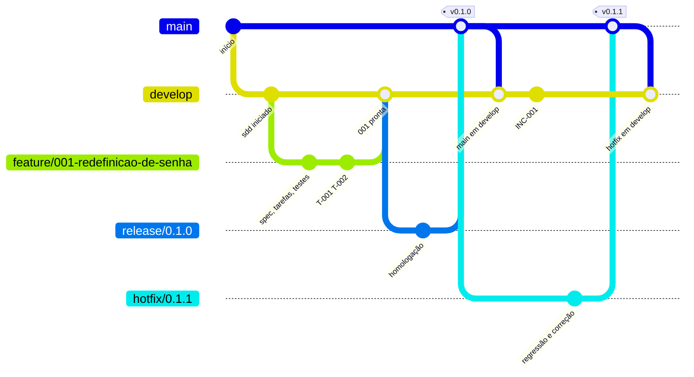

# Git Flow

Todo projeto que usa o SDD segue o mesmo Git Flow, com **os mesmos nomes de
branch**. Os comandos do plugin criam as branches, fazem os merges e as tags
nos momentos certos do ciclo, e o hook e o CI impedem que um agente invente
outro nome ou faça commit no lugar errado.

## Sumário

1. [O modelo](#1-o-modelo)
2. [Por que os nomes são fixos](#2-por-que-os-nomes-são-fixos)
3. [O ciclo inteiro num gráfico](#3-o-ciclo-inteiro-num-gráfico)
4. [Cada momento do SDD e o que acontece no git](#4-cada-momento-do-sdd-e-o-que-acontece-no-git)
5. [Integração local ou por pull request](#5-integração-local-ou-por-pull-request)
6. [O que o plugin impede](#6-o-que-o-plugin-impede)
7. [O CI](#7-o-ci)
8. [Projeto que já existe: trazer as branches para o padrão](#8-projeto-que-já-existe-trazer-as-branches-para-o-padrão)
9. [Os históricos do SDD e os merges](#9-os-históricos-do-sdd-e-os-merges)
10. [O utilitário sdd-gitflow](#10-o-utilitário-sdd-gitflow)
11. [Perguntas frequentes](#11-perguntas-frequentes)
12. [Problemas comuns](#12-problemas-comuns)

---

## 1. O modelo

| Branch | Para quê | Nasce de | Termina em | Quem cria |
|---|---|---|---|---|
| `main` | o que está em produção; cada versão é uma tag `vX.Y.Z` | (a primeira) | | você, no primeiro commit |
| `develop` | integração: tudo que está pronto e espera uma release | `main` | | `/sdd:iniciar` |
| `feature/NNN-slug` | uma feature do SDD; o nome é o id da pasta `specs/NNN-slug/` | `develop` | `develop` | `/sdd:especificar` |
| `release/X.Y.Z` | uma release, da preparação ao go/no-go; vai para homologação | `develop` | `main` (com a tag) e `develop` | `/sdd:release preparar` |
| `hotfix/X.Y.Z` | a correção de um incidente em produção | `main` | `main` (com a tag) e `develop` | `/sdd:incidente hotfix` |

E os fluxos permitidos entre elas:

| De | Para | Quando |
|---|---|---|
| `feature/*` | `develop` | a feature ficou pronta |
| `release/*` | `main` | depois do go/no-go |
| `release/*` | `develop` | as correções da homologação voltam |
| `hotfix/*` | `main` | depois do go/no-go da release de correção |
| `hotfix/*` | `develop` | a correção volta para o desenvolvimento |
| `main` | `develop` | depois de cada versão (o `sdd-gitflow finalizar` faz) |

Qualquer outro fluxo (uma feature direto para `main`, `develop` para `main`) é
recusado pelo CI.

## 2. Por que os nomes são fixos

Se cada projeto escolhe os seus nomes, cada agente também escolhe: um cria
`develop`, outro `development`, um terceiro `dev`; as features viram
`feat/x`, `feature-x`, `features/x`, `bugfix/x`. O resultado é o mesmo
problema das pastas: ninguém sabe onde está o quê, e os scripts, o CI e as
regras de proteção da plataforma precisam ser ajustados projeto a projeto.

Por isso o plugin não tem chave de configuração para os nomes. É `main`,
`develop`, `feature/`, `release/`, `hotfix/` e `vX.Y.Z` em todo projeto. O
que se escolhe por projeto é só:

| Chave do `.sdd/config.yml` | Valores | Para quê |
|---|---|---|
| `gitflow` | `ativo` (padrão) ou `desligado` | desligar o Git Flow num projeto que não o usa (o plugin não cria nem confere branches) |
| `integracao` | `local` (padrão) ou `pr` | como uma branch entra em outra: merge feito pelo plugin, ou pull request na plataforma |

## 3. O ciclo inteiro num gráfico

Uma feature, uma release e um hotfix:



O mesmo ciclo, como fica no `git log --graph` de um projeto real (a
[simulação do ciclo](../../tests/simular-ciclo.sh) produz este histórico):

```
*   merge: main em develop depois da 0.1.1
|\
| *   (tag: v0.1.1, main) release: hotfix/0.1.1 em main
| |\
| | * (hotfix/0.1.1) docs(release): changelog 0.1.1
| | * fix(002): T-001 invalida o link após o uso
| |/
* | docs(002): INC-001 hotfix aberto
* | docs: INC-001 aberto e mitigado
* | chore(release): 0.1.0 em produção
* | merge: main em develop depois da 0.1.0
|\|
| *   (tag: v0.1.0) release: release/0.1.0 em main
| |\
| | * (release/0.1.0) chore(release): 0.1.0 pronta para produção
| |/
|/|
* |   merge: feature/001-redefinicao-de-senha em develop (feature 001-redefinicao-de-senha pronta)
|\ \
| * | feat(001): T-001 T-002 redefinição de senha
|/ /
* / chore: sdd iniciado
|/
* chore: início
```

## 4. Cada momento do SDD e o que acontece no git

Você usa os comandos do SDD de sempre; o Git Flow acontece junto. Os comandos
do terminal na coluna do meio são os que o agente roda (e você pode rodar).

### 4.1 Preparar o repositório

| Você | O agente | No git |
|---|---|---|
| faz o primeiro commit em `main` | | `main` existe |
| `/sdd:iniciar` | pergunta `integracao` (`local` ou `pr`), roda `sdd-gitflow iniciar` | cria `develop` a partir de `main` e muda para ela |
| | commit `chore: sdd iniciado` | em `develop` |
| publica | | `git push -u origin main develop` |

Depois, proteja `main` e `develop` na plataforma (só por pull request, CI
obrigatório, sem force-push). O `/sdd:pipeline` lembra disso.

### 4.2 Uma feature

| Você | O agente | No git |
|---|---|---|
| `/sdd:especificar <mudança>` | `sdd-estado nova` e `sdd-gitflow feature NNN-slug` | cria `feature/NNN-slug` a partir de `develop` e muda para ela |
| todas as fases, até pronta | commits `tipo(NNN): T-XXX descrição` | em `feature/NNN-slug` |
| `/sdd:aprovar` (entrega) | commit do que a aprovação e a consolidação mudaram (`docs(NNN): feature pronta`); pergunta se integra; `sdd-gitflow integrar NNN-slug` (ou o pull request) | merge `--no-ff` em `develop` |
| publica | | `git push origin develop` |

### 4.3 Uma release

| Você | O agente | No git |
|---|---|---|
| `/sdd:release preparar` | `sdd-release analisar` sugere a versão pelos commits ([versionamento](versionamento.md)); confere que as features estão em `develop`; **primeiro** `sdd-gitflow release X.Y.Z`, depois `sdd-release nova` e `incluir`, já na branch | cria `release/X.Y.Z` a partir de `develop` |
| `/sdd:release homologar` | implanta em homologação | o push de `release/X.Y.Z` dispara o deploy de homologação no pipeline |
| (correção pedida na homologação) | commits da correção | em `release/X.Y.Z` |
| `/sdd:release implantar`, antes do go | `sdd-release changelog X.Y.Z --escrever` | commit `docs(release): changelog X.Y.Z` em `release/X.Y.Z` |
| `/sdd:release implantar`, e "go" | `sdd-release autorizar`; pergunta e roda `sdd-gitflow finalizar X.Y.Z` | merge em `main`, tag `vX.Y.Z`, merge de `main` em `develop` |
| publica | | `git push origin main develop vX.Y.Z`; a tag dispara o deploy de produção, que confere o go |
| `/sdd:release concluir` | depois da verificação, em `develop`; commit `chore(release): X.Y.Z em produção` | `git branch -d release/X.Y.Z` (local) |

### 4.4 Um hotfix

| Você | O agente | No git |
|---|---|---|
| `/sdd:incidente abrir` | registra o incidente | commit do registro em `develop` |
| `/sdd:incidente hotfix` | `sdd-incidente hotfix` reserva `hotfix/X.Y.Z` (a próxima patch); commit do registro em `develop` **sem** a pasta nova em `specs/` (`git add -A ':!specs/'`, mensagem `docs(NNN): INC-NNN hotfix aberto`); `sdd-gitflow feature NNN-slug` | cria `hotfix/X.Y.Z` a partir de **`main`**, levando a pasta do hotfix, que é commitada lá |
| red, green, spec retroativa | commits `fix(NNN): T-XXX ...` | em `hotfix/X.Y.Z` |
| release de correção (`--hotfix`, mesma versão) e "go" | `sdd-gitflow finalizar X.Y.Z` | merge em `main`, tag `vX.Y.Z`, merge em `develop` |

## 5. Integração local ou por pull request

| | `integracao: local` | `integracao: pr` |
|---|---|---|
| para quem | quem trabalha sozinho, ou time pequeno sem revisão de código | time com revisão de código na plataforma |
| feature pronta | `sdd-gitflow integrar NNN-slug` faz o merge `--no-ff` em `develop` | o agente propõe `gh pr create --base develop --head feature/NNN-slug` |
| release com o go | `sdd-gitflow finalizar X.Y.Z` faz o merge em `main`, a tag e o merge em `develop` | pull request `release/X.Y.Z` para `main`; depois do merge na plataforma e do `git pull` em `main`, `sdd-gitflow finalizar X.Y.Z --apos-pr` faz a tag e o merge em `develop` |
| push | você publica (`git push`); o plugin nunca faz push | a plataforma faz o merge; você publica a tag |

Nos dois casos, o plugin pergunta antes de cada merge e nunca faz push,
force-push, rebase de branch publicada ou exclusão de branch remota.

## 6. O que o plugin impede

O hook `guarda-commits` age nas proteções `leve` e `estrita`, com o Git Flow
ativo:

| Tentativa | Resultado |
|---|---|
| `git checkout -b feat-login`, `git switch -c bugfix/x`, `git branch dev` | bloqueado: nome fora do padrão |
| `git branch -m develop2` | bloqueado: o nome novo está fora do padrão |
| `git switch -c feature/009-nada` (a feature 009 não existe) | bloqueado: feature nasce pelo `/sdd:especificar` |
| `git switch -c release/1.2.0`, `git switch -c feature/001-login` (feature existente) | permitido |
| `git commit` em `main` | bloqueado: `main` só recebe merge, depois do go |
| `git commit` numa branch fora do padrão | bloqueado: renomeie antes |
| `git commit` em `develop` com uma feature ativa em andamento | bloqueado: o commit é na branch dela |
| `git commit` na branch da feature ativa | permitido (com a tarefa na mensagem, nas fases de implementação) |
| `git commit` em `release/X.Y.Z` com a feature ativa reprovada na homologação | permitido: a correção vai na release |
| `git commit` em `develop` do registro de um incidente, quando a feature ativa é o hotfix e a branch dele ainda não existe | permitido |
| `git commit` durante um merge com conflito | permitido: é a resolução |

Ao trocar de branch, o `sdd-gitflow` leva junto as alterações pendentes nos
arquivos do SDD (`specs/`, `sistema/`, `releases/`, `incidentes/`, `docs/`,
`.sdd/`, `CLAUDE.md`, `AGENTS.md`, `.gitattributes`, `CHANGELOG.md`), que são commitadas na branch nova, e
**recusa** se houver alteração pendente em código, para que o trabalho de uma
branch não vaze para outra. Se o git não conseguir levar um arquivo (ele é
diferente na outra branch), o `sdd-gitflow` explica e pede o commit (ou o
`git stash`). Os merges (`integrar`, `finalizar`) exigem tudo commitado.

Os hooks são trilhos contra deslizes, não um sandbox: um comando de shell
menos comum escapa. A garantia determinística é o CI.

## 7. O CI

Os modelos de pipeline do `/sdd:pipeline` seguem o Git Flow:

| Evento | O que roda |
|---|---|
| push em `main`, `develop`, `release/**`, `hotfix/**`, e todo pull request | lint, testes, `sdd-verificar`, varreduras de segurança |
| pull request | o `sdd-verificar` lê a origem e o destino (`GITHUB_HEAD_REF` e `GITHUB_BASE_REF`, ou as variáveis do GitLab) e **falha** se o fluxo não é permitido |
| push em `release/**` ou `hotfix/**` | deploy em homologação |
| tag `vX.Y.Z` | `sdd-release pode-implantar X.Y.Z` (o go) e o deploy de produção |

O pipeline baixa o plugin numa versão fixa (`SDD_VERSAO`). As conferências de
Git Flow do `sdd-verificar` só existem a partir da versão do plugin que as
trouxe: use a tag da versão instalada. No GitLab, o modelo tem o bloco
`workflow:` que liga os pipelines de merge request; sem ele, o fluxo do merge
request não é conferido.

Na plataforma, configure a proteção de `main` e `develop`: só por pull request,
com o estágio `verificar` obrigatório, sem push direto e sem force-push.

## 8. Projeto que já existe: trazer as branches para o padrão

O `/sdd:iniciar` faz isto na adoção (ver o guia
[projeto em andamento](projeto-em-andamento.md)). Em resumo:

1. `sdd-gitflow conferir` lista o que está fora do padrão:

   ```
   Git Flow: loja
     branch atual: master
     ✗ não existe a branch main (produção)
     ✗ não existe a branch develop (integração): rode sdd-gitflow iniciar
     ✗ development está fora do padrão: renomeie para develop (sdd-gitflow renomear development develop)
     ✗ feat-login está fora do padrão
     ✗ master está fora do padrão: renomeie para main (sdd-gitflow renomear master main)
   ```

2. Com a sua aprovação, o agente renomeia uma por vez:

   | Antiga | Nova |
   |---|---|
   | `master`, `production` | `main` |
   | `development`, `dev` | `develop` |
   | a branch de uma feature em andamento (`feat-login`) | `feature/NNN-slug` da feature adotada |
   | uma release antiga ainda aberta (`release-1.2`) | `release/1.2.0` |
   | branch sem feature correspondente | você decide: criar a feature, juntar a outra, ou deixar até ser apagada |

3. O `sdd-gitflow renomear` só renomeia **localmente** e imprime o que fazer no
   remoto, para você rodar quando o time estiver de acordo:

   ```
   Renomeada localmente: master -> main
   No remoto, quando o time estiver de acordo:
     git push -u origin main
     troque a branch padrão do repositório para main (GitHub: Settings > Branches)
     git push origin --delete master
   ```

4. `sdd-gitflow iniciar` cria `develop` (se não existir) e, se você está em `main`, muda para ela.

Avise o time antes de renomear branches publicadas: quem tem um clone precisa
atualizar (`git fetch --prune` e `git branch -u origin/main main`).

## 9. Os históricos do SDD e os merges

Os históricos (`.sdd/historico.md`, `specs/*/historico.md`,
`releases/*/historico.md`) só recebem linhas novas. Com o Git Flow, duas
branches acrescentam linhas ao mesmo histórico (o registro de um incidente em
`develop` e o do hotfix em `hotfix/X.Y.Z`, por exemplo), e o merge daria
conflito. Por isso o `/sdd:iniciar` acrescenta ao `.gitattributes`:

```
# sdd:inicio (históricos do SDD só recebem linhas: o merge junta os dois lados)
.sdd/historico.md merge=union
specs/*/historico.md merge=union
releases/*/historico.md merge=union
# sdd:fim
```

O driver `union` do próprio git junta as linhas dos dois lados. Cada linha tem
data e hora, então a ordem do arquivo depois de um merge não muda o que ele
registra. Outros arquivos (o backlog, uma spec) podem dar conflito como
qualquer código; nesse caso o agente para e resolve com você.

## 10. O utilitário sdd-gitflow

| Comando | O que faz |
|---|---|
| `sdd-gitflow conferir` | lista branches fora do padrão, a falta de `main` ou `develop`, e se você está na branch da feature ativa. Saída 3 com problemas |
| `sdd-gitflow iniciar` | garante `main`, cria `develop` a partir dela e, se você está em `main`, muda para `develop` |
| `sdd-gitflow renomear <antiga> <nova>` | renomeia uma branch local para um nome do padrão e diz o que fazer no remoto |
| `sdd-gitflow feature <NNN-slug>` | cria (a partir de `develop`, ou de `main` num hotfix) ou ativa a branch da feature |
| `sdd-gitflow release <X.Y.Z>` | cria `release/X.Y.Z` a partir de `develop` |
| `sdd-gitflow hotfix <X.Y.Z>` | cria `hotfix/X.Y.Z` a partir de `main` |
| `sdd-gitflow integrar <NNN-slug> [--apagar]` | merge `--no-ff` da feature pronta em `develop`; `--apagar` remove a branch local |
| `sdd-gitflow finalizar <X.Y.Z> [--apos-pr]` | com o go registrado: merge da `release/` (ou `hotfix/`) em `main`, tag `vX.Y.Z`, merge de `main` em `develop` |
| `sdd-gitflow esperada` | a branch em que a feature ativa deve estar |
| `sdd-gitflow valido <branch>` | saída 0 se o nome segue o padrão |
| `sdd-gitflow pode-integrar <origem> <destino>` | saída 0 se o fluxo é permitido (usado pelo CI) |
| `sdd-gitflow nome feature <NNN-slug>` (ou `release`, `hotfix` com a versão) | imprime o nome da branch |

Ele nunca faz push, nunca apaga branch remota e nunca reescreve histórico. Não
escreve nos históricos do SDD: o registro de branches, merges e tags é o
próprio git.

## 11. Perguntas frequentes

**Posso usar `master` em vez de `main`?**

Não com o Git Flow do plugin. O ponto é ter os mesmos nomes em todo projeto. O
`sdd-gitflow renomear master main` faz a troca local e diz o que fazer no
remoto. Se um projeto não pode mudar (um cliente que exige outro modelo),
desligue o Git Flow nele (`gitflow: desligado`).

**E as correções de bug que não são hotfix?**

São features do SDD, normalmente de nível 1: `feature/NNN-corrige-x`, a partir
de `develop`. Não existe `bugfix/`: um bug é uma mudança de comportamento como
outra qualquer, com spec e testes. `hotfix/` é só para o que está quebrado em
produção e não pode esperar a próxima release.

**Mudança de nível 0 (um typo) também precisa de branch?**

Não precisa de feature, então não tem `feature/`. Ela vai em `develop` (ou na
branch da feature em que você está, se for dela), num commit comum.

**O plugin faz push?**

Nunca. Ele diz o comando (`git push origin develop`, `git push origin main
develop vX.Y.Z`), e você roda, ou pede ao agente para rodar.

**Duas features ao mesmo tempo?**

Cada uma na sua branch. Troque com `sdd-estado usar NNN-slug` e
`sdd-gitflow feature NNN-slug`. O hook confere que o commit vai na branch da
feature ativa.

**Uma feature foi reprovada na homologação. Onde corrijo?**

Em `release/X.Y.Z`: a release é o que está sendo homologado. Depois do go, o
`sdd-gitflow finalizar` leva a correção para `main` e de volta para `develop`.

## 12. Problemas comuns

| Mensagem | Causa | O que fazer |
|---|---|---|
| `SDD (Git Flow) bloqueou a branch 'x': o nome está fora do padrão` | um agente tentou criar uma branch com outro nome | use `sdd-gitflow feature`, `release` ou `hotfix` |
| `SDD (Git Flow) bloqueou um commit direto em main` | commit em `main` | faça o trabalho em `develop` ou na branch da feature; `main` recebe pelo `sdd-gitflow finalizar` |
| `SDD (Git Flow) bloqueou o commit em 'develop': a feature ativa ... é feita em feature/...` | a feature ativa tem branch própria | `sdd-gitflow feature NNN-slug`; se o commit não é da feature, `sdd-estado definir feature=` |
| `sdd-gitflow: há alterações não commitadas em código` | trocar de branch levaria o código de outro trabalho junto | faça o commit (ou o stash) e rode de novo |
| `sdd-gitflow: há alterações não commitadas. Faça o commit antes` | `integrar` ou `finalizar` com algo pendente | faça o commit na branch atual |
| `sdd-gitflow: o git não trocou de branch` | um arquivo pendente é diferente na outra branch | faça o commit, ou `git stash`, rode de novo e `git stash pop` |
| `a release X.Y.Z está em '...'. Ela só vai para main depois do go/no-go` | `finalizar` antes do `sdd-release autorizar` | conclua a homologação e o go no `/sdd:release` |
| `conflito ao integrar ...` | as duas branches mudaram o mesmo trecho | resolva os arquivos, `git add`, `git commit`; ou `git merge --abort` |
| CI: `o pull request feature/... -> main não é permitido` | pull request para o destino errado | feche e abra para `develop` |
| `a feature NNN-slug não existe` ao renomear | a feature ainda não foi criada ou adotada | adote ou crie a feature antes |
