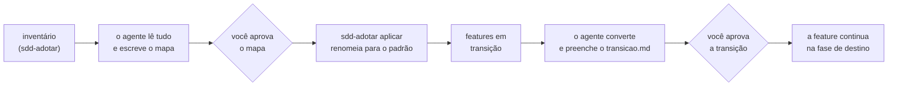

# Adotar o SDD num projeto em andamento

Este guia leva um projeto que já existe (com código, e talvez com specs,
planos e tarefas que outros agentes ou outros processos deixaram) até o ponto em
que o plugin trabalha nele como se o tivesse criado. Nada é apagado, o histórico
do git é preservado, e uma feature que estava pela metade **continua de onde
parou**.

Para um repositório vazio, o guia certo é o
[começar um projeto novo](projeto-novo.md).

## Sumário

1. [Qual é a sua situação](#1-qual-é-a-sua-situação)
2. [Como a adoção funciona, em uma página](#2-como-a-adoção-funciona-em-uma-página)
3. [Antes de começar](#3-antes-de-começar)
4. [Instalar o plugin](#4-instalar-o-plugin)
5. [Ver o que existe](#5-ver-o-que-existe)
6. [Preparar o repositório: /sdd:iniciar](#6-preparar-o-repositório-sddiniciar)
7. [O mapa: para onde vai cada arquivo](#7-o-mapa-para-onde-vai-cada-arquivo)
8. [Aplicar o mapa](#8-aplicar-o-mapa)
9. [A conversão: como era e como vai ficar](#9-a-conversão-como-era-e-como-vai-ficar)
10. [Aprovar a transição](#10-aprovar-a-transição)
11. [Continuar de onde parou](#11-continuar-de-onde-parou)
12. [O resto do projeto: o que não precisa de spec](#12-o-resto-do-projeto-o-que-não-precisa-de-spec)
13. [Manter o padrão daqui para a frente](#13-manter-o-padrão-daqui-para-a-frente)
14. [Desfazer](#14-desfazer)
15. [Perguntas frequentes](#15-perguntas-frequentes)
16. [Problemas comuns](#16-problemas-comuns)

---

## 1. Qual é a sua situação

| O projeto tem | Passos deste guia |
|---|---|
| só código, sem nenhum documento de processo | 3 a 6, e depois 12 e 13 (não há adoção) |
| specs, planos, tarefas ou ADRs soltos, de outro agente ou de outra ferramenta (`docs/specs/`, `tasks/`, `TODO.md`, `PLAN.md`, `.kiro/`, `.specify/`, `docs/decisions/`) | todos |
| uma feature pela metade, com parte das tarefas feita | todos, com atenção aos passos 9 a 11 |
| já usa o SDD, mas um agente criou arquivos fora do padrão | 7 a 11, com `/sdd:iniciar --adotar` |

## 2. Como a adoção funciona, em uma página



Três ideias explicam tudo:

| Ideia | O que significa |
|---|---|
| **Layout** | cada artefato de processo tem um único lugar: `specs/NNN-slug/`, `docs/adr/NNNN-slug.md`, `.sdd/`, `sistema/`, `docs/arquitetura/`, `docs/legado/`. A adoção traz para lá o que está fora |
| **Transição** | toda feature adotada nasce "em transição": nada é aprovado e nada avança até você aprovar o `transicao.md`, que mostra **como era** e **como vai ficar** |
| **Marca `[O]`** | a tarefa que o outro processo já fez fica `[O]` (feita fora do plugin, sem gate). Ela não é refeita; os testes dela vêm na fase red e devem passar de início |

Há dois gates humanos: o **mapa** (para onde vai cada arquivo) e a
**transição** de cada feature (o antes e o depois do conteúdo). O agente nunca
aprova nenhum dos dois.

## 3. Antes de começar

| Faça | Por quê |
|---|---|
| marque o ponto de partida: `git tag antes-do-sdd` | a adoção vira alguns commits comuns; a tag é o ponto para comparar ou voltar |
| deixe a árvore limpa: `git status` sem nada pendente | o "como era" de cada arquivo fica no último commit |
| versione os documentos que vão ser adotados (`git add`, `git commit`) | arquivo fora do git perde o original na conversão; o agente copia para `docs/legado/` nesse caso, mas é melhor ter no git |
| confira o `git config user.name` | é o nome registrado em cada aprovação |
| confira que os testes rodam (`npm test`, `pytest`...) | a fase red das features adotadas precisa deles |
| liste as branches: `git branch -a` | o plugin usa o Git Flow com nomes fixos (`main`, `develop`, `feature/NNN-slug`, `release/X.Y.Z`, `hotfix/X.Y.Z`); as branches com outros nomes serão renomeadas, com a sua aprovação |

## 4. Instalar o plugin

```bash
claude plugin marketplace add geraldodominguez/sdd-plugin
claude plugin install sdd@sdd-plugin
```

## 5. Ver o que existe

Opcional: o `/sdd:iniciar` faz isto sozinho. Mas ver antes ajuda a planejar.
Numa sessão do Claude Code no projeto, peça para rodar `sdd-adotar inventario`
(ou rode no terminal, pelo caminho do plugin). Ele funciona antes de o projeto
usar o SDD. Num projeto de exemplo, uma loja com a exportação de pedidos pela
metade:

```
Este projeto não foi preparado pelo SDD e tem 4 artefato(s) de outro processo.

spec (1) · padrão: specs/NNN-slug/ (crie a feature com sdd-estado nova; nunca crie a pasta à mão)
  - docs/specs/exportar-pedidos.md

tarefas (2) · padrão: specs/NNN-slug/ (crie a feature com sdd-estado nova; nunca crie a pasta à mão)
  - TODO.md
  - tasks/exportar-pedidos.md

adr (1) · padrão: docs/adr/NNNN-slug.md (numeração sequencial de 4 dígitos, a partir do template de ADR)
  - docs/decisions/banco.md

Para trazer ao padrão: /sdd:iniciar --adotar (lê cada arquivo, propõe o mapa e pede a sua aprovação).
```

O inventário reconhece pelo **nome e pela pasta**: spec, PRD, requisitos,
plano, design, tarefas, TODO, ADR, decisões, backlog, roadmap, sprint,
arquitetura, convenções, em markdown ou diagrama. Ignora `node_modules/`,
`vendor/`, `dist/`, `build/` e afins, e tudo que casar com
`excecoes_de_layout`. Documentos com nomes incomuns (requisitos numa ata, um
plano em `notas.md`) o agente procura na leitura do passo 7.

## 6. Preparar o repositório: /sdd:iniciar

```
/sdd:iniciar
```

O agente:

1. roda o inventário e, se ele não está vazio, avisa que o projeto não nasceu com o plugin e que os artefatos serão adotados depois da preparação;
2. pergunta o nível padrão e a proteção. Para adotar, a **proteção `leve`** é a recomendada: a `estrita` exige disciplina de fases desde o primeiro dia;
3. cria `.sdd/`, `specs/`, `sistema/` e `docs/adr/`, e injeta o bloco de regras no `CLAUDE.md` e no `AGENTS.md` (o resto desses arquivos fica intacto);
4. prepara a base do **Git Flow**, antes de qualquer commit: pergunta a `integracao` (`local` ou `pr`); se a produção se chama `master` ou a integração `development`, propõe renomear para `main` e `develop` (passo 6.1); e roda `sdd-gitflow iniciar`, que cria `develop` e muda para ela. Toda a adoção é commitada em `develop`;
5. rascunha a **constituição** só com o que observou no código: stack e versões dos manifestos, camadas, convenções, comandos de teste e lint, como se implanta hoje. O que não conseguir confirmar fica `{{a definir}}`. Regra que o projeto já descumpre vai para "Exceções aprovadas", com o plano de saída;
6. propõe o `.sdd/config.yml`: `globs_de_teste` na convenção real do projeto, `areas_sensiveis`, `comando_teste` e os comandos de entrega que conseguir descobrir;
7. segue para a adoção (passos 7 a 10) antes de te mostrar tudo no gate.

### 6.1 As branches de produção e de integração

O `sdd-gitflow conferir` mostra o que está fora do padrão:

```
Git Flow: loja
  branch atual: master
  ✗ não existe a branch main (produção)
  ✗ não existe a branch develop (integração): rode sdd-gitflow iniciar
  ✗ development está fora do padrão: renomeie para develop (sdd-gitflow renomear development develop)
  ✗ feat-exportar está fora do padrão
  ✗ master está fora do padrão: renomeie para main (sdd-gitflow renomear master main)
```

Com a sua aprovação, o agente renomeia `master` para `main` e `development`
para `develop` (as branches de feature ficam para o passo 9, quando as features
existirem). O `sdd-gitflow renomear` só mexe na cópia local e imprime o que
fazer no remoto, para você rodar quando o time estiver de acordo:

```
Renomeada localmente: master -> main
No remoto, quando o time estiver de acordo:
  git push -u origin main
  troque a branch padrão do repositório para main (GitHub: Settings > Branches)
  git push origin --delete master
```

Se o projeto já publicou versões, a última precisa da tag `vX.Y.Z` em `main`:
é dela que o plugin calcula a próxima versão. Tags em outro formato (`1.4.2`,
`release-1.4.2`) aparecem como aviso no `conferir`, e o agente propõe criar
`v1.4.2` no mesmo commit. Os commits antigos, que talvez não sigam o
Conventional Commits, ficam antes da tag e não contam (ver
[versionamento](versionamento.md#8-projeto-que-já-existe)).

Depois, `sdd-gitflow iniciar` cria `develop` (se ainda não existir) e muda para
ela. Detalhes em [Git Flow](git-flow.md#8-projeto-que-já-existe-trazer-as-branches-para-o-padrão).

### 6.2 O que espera a adoção

Logo depois do `sdd-iniciar`, o `/sdd:pendencias` já mostra o que espera a
adoção:

```
Esperando você: 4 item(ns)

Fora do padrão (4) · /sdd:iniciar --adotar
  - TODO.md (tarefas)
  - docs/decisions/banco.md (adr)
  - docs/specs/exportar-pedidos.md (spec)
  - tasks/exportar-pedidos.md (tarefas)
```

## 7. O mapa: para onde vai cada arquivo

O agente lê **cada arquivo por inteiro** (e a pasta inteira, quando ela é de
outra ferramenta), agrupa o que descreve a mesma mudança e olha o código para
saber o que já foi implementado. Então decide um destino para cada arquivo:

| O arquivo é | Vai para | Atalho no mapa |
|---|---|---|
| spec, PRD ou requisitos de algo não implementado ou pela metade | uma feature nova, em transição | `feature:<slug>/spec.md` |
| plano ou design técnico da mesma mudança | a mesma feature | `feature:<slug>/plano.md` |
| tarefas da mesma mudança | a mesma feature | `feature:<slug>/tarefas.md` |
| spec de algo já implementado e entregue | `docs/legado/` (não se especifica o passado) | `legado:specs/<nome>.md` |
| decisão de arquitetura | `docs/adr/NNNN-slug.md`, numerado | `adr:<slug>` |
| backlog, roadmap, TODO solto | itens em aberto no `.sdd/backlog.md`; o arquivo vai para o legado | `legado:<nome>.md` |
| sprint de outro processo | `docs/legado/`; a sprint do SDD se replaneja | `legado:sprints/<nome>.md` |
| regras e convenções | o conteúdo vai para a constituição; o arquivo, para o legado | `legado:<nome>.md` |
| arquitetura, diagramas, C4 | `docs/arquitetura/`, como referência | `arquitetura:<nome>` |
| duplicata, rascunho abandonado, segunda spec da mesma feature | `docs/legado/` (nunca se apaga) | `legado:<caminho>` |
| documento que não é de processo, mas tem nome de artefato | fica onde está | entra em `excecoes_de_layout` |

O mapa fica em `.sdd/adocao-mapa.txt`, uma linha por arquivo, com o motivo em
comentário:

```
# Exportar pedidos: spec e tarefas da mesma mudança, em andamento (CSV feito, PDF não)
docs/specs/exportar-pedidos.md -> feature:exportar-pedidos/spec.md
tasks/exportar-pedidos.md -> feature:exportar-pedidos/tarefas.md

# Decisão de arquitetura
docs/decisions/banco.md -> adr:usar-postgres

# TODO solto: o item aberto vai para o backlog, o arquivo para o legado
TODO.md -> legado:TODO.md
```

O mesmo slug junta os arquivos numa mesma feature. A numeração (`001`,
`0001`) é do utilitário, nunca do agente. Antes de te mostrar, o agente confere
o mapa com uma simulação:

```
Simulação: 4 arquivo(s). Nada foi movido.

  docs/specs/exportar-pedidos.md
    -> specs/001-exportar-pedidos/spec.md
  tasks/exportar-pedidos.md
    -> specs/001-exportar-pedidos/tarefas.md
  docs/decisions/banco.md
    -> docs/adr/0001-usar-postgres.md
  TODO.md
    -> docs/legado/TODO.md

Features novas (nascem em transição, à espera da conversão e da sua aprovação):
  + specs/001-exportar-pedidos
```

**Gate do mapa: o que olhar antes de dizer "sim"**

- Cada feature nova corresponde a uma mudança de verdade, e não a duas misturadas.
- Nada que ainda vale foi mandado para o legado, e nada morto virou feature.
- Specs de coisas já entregues foram para o legado, não para feature.
- As dúvidas que o agente listou têm resposta.

Sem o seu "sim", nada se move. Se ninguém está acompanhando a sessão, o agente
para aqui, com o mapa e a simulação prontos.

## 8. Aplicar o mapa

Com o "sim", o agente roda `sdd-adotar aplicar`:

```
Adotados: 4 arquivo(s). Registro em .sdd/adocao.md.

Features em transição (converta os arquivos para o padrão, preencha o transicao.md e aprove a transição com /sdd:aprovar):
  + specs/001-exportar-pedidos

Ainda citam o caminho antigo (atualize os links):
  ! README.md cita docs/specs/exportar-pedidos.md
```

O que aconteceu:

| Efeito | Detalhe |
|---|---|
| arquivos renomeados para o padrão | com `git mv`: o `git log --follow` mostra a história inteira |
| features numeradas e criadas em **transição** | `specs/001-exportar-pedidos/estado` tem `fase=especificacao` e `adocao=transicao`, e nenhuma aprovação |
| `transicao.md` criado do modelo | com o "como era" de cada arquivo já preenchido: caminho original e hash |
| ADR numerado | `docs/adr/0001-usar-postgres.md` |
| registro | cada movimento em `.sdd/adocao.md`, no histórico do projeto e no da feature, com o hash do original |
| pastas vazias removidas | só as que ficaram vazias |
| links apontados | os arquivos que ainda citam o caminho antigo |

O mapa inteiro é conferido antes do primeiro movimento: se uma linha estiver
errada (origem que não existe, destino que já existe, destino fora do padrão),
nada é movido.

Depois, o agente:

- põe os itens em aberto do backlog, roadmap e TODO no backlog (`sdd-backlog adicionar "Cupom de desconto" --origem "adoção: TODO.md"`);
- leva para a constituição as regras de outro processo que ainda valem;
- atualiza os links que o `aplicar` listou;
- preenche `excecoes_de_layout`, se você aprovou alguma;
- apaga o `.sdd/adocao-mapa.txt` (o registro fica no `.sdd/adocao.md`);
- sugere um commit em `develop`: `chore: adoção do SDD, arquivos no padrão`.

Faça esse commit. Assim a conversão do passo seguinte fica num commit
separado (na branch de cada feature), e o diff dela mostra exatamente o que
mudou em cada arquivo.

Neste ponto, o quadro mostra a feature em transição:

```
Especificação
    001-exportar-pedidos               n1 · especificacao · em transição · aguarda aprovação
```

## 9. A conversão: como era e como vai ficar

Os arquivos já têm o nome do padrão (`spec.md`, `tarefas.md`), mas ainda o
conteúdo do outro processo. Para cada feature, o agente:

### 9.1 Ativa a feature e acerta o nível

`sdd-estado usar 001-exportar-pedidos`. Se a feature mexe em domínio, schema,
contrato público ou segurança, ele propõe o nível 2. Ele também define a
capacidade da spec do sistema (`sdd-estado definir capacidade=pedidos`).

E vai para a **branch da feature**, onde a conversão é commitada:

| O código feito fora do plugin | O que o agente faz (perguntando antes) |
|---|---|
| já está em `develop` (ou não há código) | `sdd-gitflow feature 001-exportar-pedidos`: cria `feature/001-exportar-pedidos` a partir de `develop` |
| está numa branch antiga que não entrou em `develop` (`feat-exportar`) | `sdd-gitflow renomear feat-exportar feature/001-exportar-pedidos`, `sdd-gitflow feature 001-exportar-pedidos` e `git merge develop`, para a branch receber os arquivos adotados |

### 9.2 Descobre onde a feature parou

Para cada tarefa do original, ele procura no código a evidência de que foi
feita (caminho e linha). **A caixa marcada no arquivo antigo não basta**: sem
evidência, a tarefa conta como aberta. Daí sai a **fase de destino**:

| A feature tem | Continua em |
|---|---|
| só uma ideia, ou requisitos com dúvidas que mudam o escopo | `especificacao` |
| spec clara, nível 2, sem plano técnico | `plano` |
| spec clara (e plano, no nível 2), sem tarefas | `tarefas` |
| spec e tarefas (e plano, no nível 2), algumas feitas ou nenhuma | `red` |

### 9.3 Reescreve cada arquivo no modelo do SDD

| Arquivo | Como era | Como vai ficar |
|---|---|---|
| `spec.md` | texto livre: "Exportar em CSV, com data, cliente e valor." | `RF-001` em EARS e `CA-001` em Dado, Quando, Então, no modelo da spec |
| `plano.md` (nível 2) | um design técnico qualquer | o modelo do plano, cada decisão ligada a um requisito |
| `tarefas.md` | `- [x] gerar CSV com data, cliente e valor` | `- [O] T-001 gerar CSV com data, cliente e valor (atende: RF-001, CA-001; depende de: nada)` |

As três marcas de tarefa:

| Marca | Significado | Quem escreve |
|---|---|---|
| `[O]` | feita **fora** do plugin, antes da adoção, sem gate, com evidência no código | só a conversão |
| `[ ]` | aberta: o plugin continua daqui | a conversão e o `/sdd:tarefas` |
| `[x]` | feita **no** plugin, com os testes verdes | só o `/sdd:implementar` |

O agente não inventa requisito, critério ou tarefa que o original não tem. O
que não coube em lugar nenhum vai para "O que ficou de fora", com o destino
(backlog, legado ou descartado, com o motivo).

Ele também procura os **testes que já existem** para as tarefas `[O]` e os
lista. Eles ganham a marca `sdd:NNN:CA-XXX` na fase red, não agora.

### 9.4 Preenche o transicao.md

O `transicao.md` é o documento que você aprova. No exemplo da loja (o arquivo
completo está em [exemplos/adocao](../../exemplos/adocao/)):

```markdown
| Campo | Valor |
|---|---|
| Feature | 001-exportar-pedidos |
| Adotada em | 2026-10-29 |
| Fase de destino | red |
| Por quê | spec e tarefas claras; CSV e botão já implementados (src/pedidos/exportar.ts:1) |

## Como era

| Arquivo original | Hash do original | Agora em |
|---|---|---|
| `docs/specs/exportar-pedidos.md` | ad347b30563f | `spec.md` |
| `tasks/exportar-pedidos.md` | 138bc4003898 | `tarefas.md` |

## Como vai ficar

| Como era (trecho original) | Como vai ficar |
|---|---|
| Exportar em CSV, com data, cliente e valor. | RF-001, CA-001 |
| Exportar em PDF, com o logo da loja. | RF-002, CA-002 |
| Só o dono da loja pode exportar. | RF-003, CA-003 |

| Como era (linha original) | Como vai ficar | Marca |
|---|---|---|
| `- [x] gerar CSV com data, cliente e valor` | T-001 | O: feita fora do plugin |
| `- [x] botão de exportar na tela de pedidos` | T-002 | O: feita fora do plugin |
| `- [ ] gerar PDF com o logo` | T-003 | aberta: o plugin continua daqui |
| `- [ ] restringir ao dono da loja` | T-004 | aberta: o plugin continua daqui |
```

O "como era" dos arquivos vem do utilitário; o resto, da conversão. Nenhum
campo `{{...}}` pode sobrar: o utilitário recusa a aprovação enquanto houver.

## 10. Aprovar a transição

```
sdd-estado usar 001-exportar-pedidos     # se ela não for a feature ativa
/sdd:aprovar
```

**O que olhar antes de dizer "sim":**

| Pergunta | Onde |
|---|---|
| Os requisitos dizem o que o original dizia, nem mais, nem menos? | tabela de requisitos do `transicao.md`, e `spec.md` |
| Cada `[O]` tem evidência no código? | "Situação encontrada" |
| Alguma tarefa marcada no original virou `[ ]`? Por quê? | tabela de tarefas |
| A fase de destino faz sentido? | "Fase de destino" e "Por quê" |
| Nada se perdeu? | "O que ficou de fora" |
| Quer ver o diff do conteúdo? | `git diff` contra o commit do passo 8 |

Com o "sim":

```
Transição aprovada: 001-exportar-pedidos segue no SDD a partir da fase red.
Aprovados com a transição: spec.md tarefas.md.
Tarefas feitas fora do plugin ([O]): 2. Os testes delas vêm na fase red e devem passar de início.
```

O que a aprovação registrou no `historico.md` da feature:

```
- ... | aprovacao | spec.md | hash=fc76fa2181b4 | decisao: transicao | por: Ana (tech lead)
- ... | aprovacao | tarefas.md | hash=c4f8c4e8ab91 | decisao: transicao | por: Ana (tech lead)
- ... | aprovacao | transicao.md | hash=d19f70bb82d6 | decisao: transicao | por: Ana (tech lead)
- ... | fase | especificacao para red (transição aprovada) | por: Ana (tech lead)
```

Os artefatos que a fase de destino pressupõe ficam aprovados de uma vez:

| Destino | Aprovado junto com o `transicao.md` |
|---|---|
| `especificacao` | nada mais (a spec segue o fluxo normal) |
| `plano` (só nível 2) | `spec.md` |
| `tarefas` | `spec.md`, e `plano.md` no nível 2 |
| `red` | `spec.md`, `tarefas.md`, e `plano.md` no nível 2 |

E a feature fica `adocao=regularizada`. O detalhe dela (`/sdd:status`) agora mostra, em trecho:

```
Feature 001-exportar-pedidos (nível 1) · ativa
  adoção: regularizada (veio de outro processo; ver transicao.md)
  fase: especificacao clarificacao plano tarefas [red] green seguranca auditoria pronta ...
  artefatos:
    ✓ transicao.md
    ✓ spec.md (aprovado em 2026-10-29T15:21:33Z por Ana (tech lead))
    ✓ tarefas.md (aprovado em 2026-10-29T15:21:33Z por Ana (tech lead))
  tarefas: 2/4 concluídas (2 feitas fora do plugin, marcadas [O])
  próxima: T-003 gerar PDF com o logo da loja (atende: RF-002, CA-002; depende de: T-001)
```

Faça o commit da conversão, na branch da feature: `docs(001): transição para o
SDD`.

## 11. Continuar de onde parou

Daqui em diante, o fluxo é o normal, a partir da fase de destino. No destino
`red`:

```
/sdd:implementar     # fase red
/sdd:aprovar         # os testes
/sdd:implementar     # fase green
/sdd:aprovar         # a entrega (nível 1 sem área sensível)
```

| Fase | O que acontece com as tarefas `[O]` | E com as `[ ]` |
|---|---|---|
| red | os testes que já existiam ganham a marca `sdd:001:CA-001`; os que faltam são escritos. **Devem passar** de início: é assim que o trabalho de fora é conferido | os testes são escritos e **devem falhar** (o comportamento ainda não existe) |
| green | nada: não se refazem | são implementadas e viram `[x]` |
| entrega | contam como feitas | precisam estar `[x]` |

**Se um teste de uma tarefa `[O]` falhar na fase red**, o trabalho feito fora
não cumpre a spec. O agente para e pergunta:

| Você decide | O que acontece |
|---|---|
| a tarefa está errada | ela volta a `[ ]`; o plugin a refaz na fase green, e ela vira `[x]` |
| a spec está errada | corrige-se a spec antes de aprovar os testes |

A marca `[O]` fica no `tarefas.md` para sempre, como registro do que entrou sem
gate. No fim, a feature fica pronta, é consolidada em `sistema/pedidos.md`,
entra em `develop` (`sdd-gitflow integrar 001-exportar-pedidos`, ou o pull
request) e vai numa release como qualquer outra.

Repita os passos 9 a 11 para cada feature adotada. Enquanto alguma estiver em
transição, o `/sdd:pendencias` cobra, e o `sdd-verificar` avisa no CI.

## 12. O resto do projeto: o que não precisa de spec

A adoção cuida dos documentos que existem. O código que **não** tem documento
nenhum não precisa de spec retroativa:

| Situação | O que fazer |
|---|---|
| o sistema inteiro sem spec | nada: só o que muda ganha spec. Em poucos meses, as partes mais mexidas estarão especificadas |
| uma área que você vai mudar e quer entender antes | `/sdd:sistema mapear <capacidade>`: descreve o comportamento atual a partir do código e dos testes, marcando a origem de cada item |
| área sem testes que vai ser mudada | uma primeira tarefa de **testes de caracterização**, que registram o comportamento atual antes da mudança |
| projeto sem testes nenhum | a constituição diz o que vale **daqui para a frente**; a infraestrutura de teste vira tarefa da primeira feature |
| CI que já existe | `/sdd:pipeline conferir`: acrescenta o `sdd-verificar` e o go/no-go sem reescrever o que existe |
| deploy que já existe | a release do SDD registra as decisões; o pipeline consulta o go antes do passo de produção que você já tem |

Mais em [projetos existentes](projetos-existentes.md).

## 13. Manter o padrão daqui para a frente

Depois da adoção, quatro coisas impedem que a bagunça volte:

| Camada | O que faz |
|---|---|
| o bloco de regras no `CLAUDE.md` e no `AGENTS.md` | diz a todo agente onde mora cada artefato e que feature só nasce pelo `/sdd:especificar` |
| o hook | bloqueia **criar** um artefato fora do lugar, e diz onde ele deveria estar |
| o `/sdd:pendencias` | lista o que escapou na seção "Fora do padrão" |
| o `sdd-verificar` no CI | avisa (e falha, com `--estrito`) |

Exemplos do que o hook bloqueia e permite:

| Tentativa de criar | Resultado |
|---|---|
| `docs/specs/novo.md`, `tasks/fazer.md`, `TODO.md`, `PLAN.md` | bloqueado: feature nova só pelo `/sdd:especificar` |
| `specs/009-feita-a-mao/spec.md` (pasta sem `estado`) | bloqueado: a pasta não foi criada pelo `sdd-estado nova` |
| `docs/adr/usar-redis.md` | bloqueado: o ADR é `docs/adr/NNNN-slug.md` |
| `docs/adr/0002-usar-redis.md`, `specs/001-exportar-pedidos/contexto.md` | permitido |
| `src/qualquer.ts`, `docs/guia.md` | permitido: não é artefato de processo |

Editar um arquivo que já existe continua livre. Se algo escapou (criado pelo
shell, por exemplo), rode `/sdd:iniciar --adotar`: ele repete os passos 7 a 10
só para o que está fora do padrão.

## 14. Desfazer

A adoção é feita de commits comuns, sem nada apagado:

| Quer desfazer | Como |
|---|---|
| tudo, antes de publicar | `git switch main` e `git branch -D develop` (e as `feature/` criadas); o `main` continua no ponto da tag `antes-do-sdd` |
| tudo, depois de publicar | `git revert` dos commits da adoção em `develop` (preparação, arquivos no padrão) e o descarte das branches `feature/` das features adotadas |
| a renomeação de uma branch | `sdd-gitflow` não tem desfazer: `git branch -m <nova> <antiga>` |
| só a conversão de uma feature | `git revert` do commit da conversão; a feature volta ao conteúdo original, ainda em transição |

O `.sdd/adocao.md` diz, arquivo por arquivo, de onde cada um veio.

## 15. Perguntas frequentes

**O plugin vai apagar ou reescrever alguma coisa sem me perguntar?**

Não. Nada se move sem o mapa aprovado, nada é apagado (o que não entra no fluxo
vai para `docs/legado/`), e o conteúdo só é reescrito na conversão, que você
revê no `transicao.md` e no `git diff` antes de aprovar.

**Por que a feature adotada não entra já aprovada?**

Porque ninguém aprovou aquele trabalho dentro do SDD. Entrar aprovada seria
forjar um gate. Refazer todos os gates também não faz sentido, porque o
trabalho já existe. A transição é um gate só, humano e registrado, que mostra o
antes e o depois.

**Qual a diferença entre `[O]` e `[x]`?**

`[x]` passou pelo processo: testes escritos antes, aprovados, congelados, e o
código feito para passar neles. `[O]` foi feita fora disso. As duas contam
como feitas, mas a `[O]` só é aceita de verdade quando os testes dela passam na
fase red.

**E se o agente marcar `[O]` numa tarefa que não foi feita?**

O teste dela vai falhar na fase red, e você decide. Além disso, a conversão
exige evidência no código (caminho e linha) para cada `[O]`, e você a confere
na "Situação encontrada" antes de aprovar.

**Dá para adotar só uma parte agora e o resto depois?**

Sim. Tire do mapa as linhas que quer deixar para depois. Elas continuam
aparecendo em "Fora do padrão" até você rodar `/sdd:iniciar --adotar` de novo.

**Tenho um `tasks.md` que é de um manual, não de processo.**

Ele fica onde está. Ponha o caminho em `excecoes_de_layout` no
`.sdd/config.yml`, e nem o hook nem o inventário voltam a apontá-lo.

**Tenho branches com outros nomes. O que acontece com elas?**

Nada sem você. O `sdd-gitflow conferir` lista cada uma com o nome sugerido, e
o agente propõe a troca: `master` para `main`, `development` para `develop`,
a branch de uma feature em andamento para `feature/NNN-slug`. A renomeação é
local; o remoto você atualiza quando o time estiver de acordo. Enquanto uma
branch fora do padrão existir, o hook não deixa commitar nela, e o
`/sdd:pendencias` a lista na seção "Git Flow".

**O que acontece com os ADRs adotados?**

São renomeados para `docs/adr/NNNN-slug.md` com o conteúdo original. Se
quiser, complete-os no modelo de ADR depois; para o plugin, um ADR com a
situação "proposta" aparece nas pendências.

## 16. Problemas comuns

| Mensagem | Causa | O que fazer |
|---|---|---|
| `Mapa inválido. Nada foi movido.` | uma linha do mapa tem erro (listado abaixo da mensagem) | corrija a linha e rode a simulação de novo |
| `'...' não é um lugar do padrão (use feature:, adr:, legado: ou arquitetura:)` | destino escrito à mão fora do layout | use `feature:`, `adr:`, `legado:` ou `arquitetura:` |
| `a feature '...' não existe; para uma feature nova, use feature:<slug>/<arquivo>` | caminho `specs/NNN-...` inventado | use o atalho `feature:`; a numeração é do utilitário |
| `o transicao.md ainda tem campos {{...}} por preencher` | a conversão não terminou | peça ao agente para completar |
| `o destino red pressupõe tarefas.md convertido para o padrão, e ele não existe` | falta o arquivo para a fase escolhida | converta as tarefas ou escolha o destino `tarefas` |
| `a spec tem N dúvida(s) em aberto` | `[PRECISA ESCLARECER]` na spec | esclareça antes, ou use o destino `especificacao` |
| `a fase plano só existe no nível 2` | destino `plano` numa feature de nível 1 | use `tarefas` ou `red`, ou suba para o nível 2 |
| `a feature ... veio de outro processo e está em transição. Aprove a transição primeiro` | tentativa de aprovar outro artefato ou de mudar a fase | `/sdd:aprovar` sem artefato |
| `Ainda citam o caminho antigo` | links para os arquivos que mudaram de lugar | atualize os arquivos listados |
| `a branch de produção se chama 'master'` | o `sdd-gitflow iniciar` exige `main` | `sdd-gitflow renomear master main`, com o time de acordo |
| `SDD (Git Flow) bloqueou um commit na branch '...', fora do padrão` | commit numa branch antiga | renomeie a branch (`sdd-gitflow renomear`) ou mude para a certa |
| `sdd-gitflow: há alterações não commitadas` | trocar de branch levaria o trabalho junto | faça o commit (em `develop`, se é da adoção) e rode de novo |
