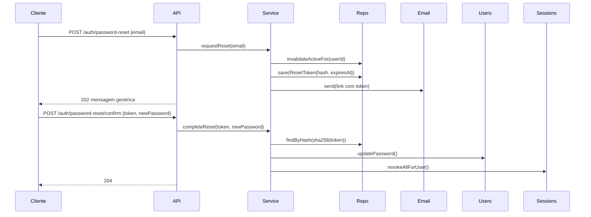

# Plano 001-redefinicao-de-senha: Redefinição de senha por e-mail

| Campo | Valor |
|---|---|
| Spec | [spec.md](./spec.md) |
| Situação | aprovado |

## 1. Checagem contra a constituição

| Regra da constituição | Atendida? | Como / exceção |
|---|---|---|
| Domínio não depende de infraestrutura | sim | `ResetToken` e `PasswordResetService` dependem de interfaces (`ResetTokenRepository`, `Clock`, `TokenGenerator`) |
| Toda entrada externa validada na fronteira | sim | Schemas zod nas rotas (`contratos/api.yaml`) |
| Segredos nunca em claro | sim | Token armazenado como SHA-256 (ADR-0007) |
| Test-first | sim | Fase red antes de qualquer implementação |
| Logs estruturados | sim | Eventos `password_reset.requested` e `password_reset.completed`, sem e-mail em claro |

## 2. Visão da solução

Um serviço de domínio `PasswordResetService` orquestra dois casos de uso:
`requestReset(email)` e `completeReset(token, newPassword)`. O token é gerado
com 32 bytes aleatórios, enviado por e-mail em base64url, e só o hash SHA-256
é persistido (RNF-002). A expiração e o uso único são invariantes da entidade
`ResetToken` (RF-002).

Para evitar enumeração (RF-001), `requestReset` sempre retorna sucesso. Quando
a conta não existe, o serviço não gera token nem envia e-mail, mas responde no
mesmo formato. O rate limit (RNF-001) reaproveita o middleware existente, com
uma chave composta.

## 3. Componentes

| Componente | Responsabilidade | Novo / alterado | Requisitos |
|---|---|---|---|
| `ResetToken` (entidade) | Expiração, uso único, substituição | novo | RF-002, RF-004, RF-005 |
| `PasswordResetService` | Casos de uso request/complete | novo | RF-001, RF-003, RF-005 |
| `ResetTokenRepository` (interface + Postgres) | Persistência por hash | novo | RNF-002 |
| `SessionStore.revokeAllForUser()` | Encerrar sessões | alterado | RF-003 |
| Rotas `POST /auth/password-reset`, `POST /auth/password-reset/confirm` | Fronteira HTTP | novo | RF-001, RF-003, RF-004 |
| `rateLimit({ key })` | Chave por e-mail e por IP | alterado | RNF-001 |

## 4. Contratos

Detalhe em [`contratos/`](./contratos/):

- **Domínio:** [`dominio.md`](./contratos/dominio.md)
- **API:** [`api.yaml`](./contratos/api.yaml)
- **Persistência:** [`persistencia.sql`](./contratos/persistencia.sql)

## 5. Fluxo principal

## 6. Tratamento de erros e casos de borda

| Situação | Comportamento | CA |
|---|---|---|
| Token expirado | 410 `RESET_LINK_EXPIRED` | CA-003 |
| Token já usado | 410 `RESET_LINK_USED` | CA-005 |
| Token substituído | 410 `RESET_LINK_SUPERSEDED` | CA-006 |
| Senha fora da política | 422 `PASSWORD_POLICY`; token **não** é consumido | CA-009 |
| Limite excedido | 429 | CA-007 |
| Falha no envio de e-mail | Retry do `EmailService`; resposta continua 202 | nenhum |

## 7. Dependências

Nenhuma nova. Usa `node:crypto` (`randomBytes`, `createHash`).

## 8. Estratégia de testes

- **Unitários:** `ResetToken` (expiração com `Clock` falso, uso único, substituição).
- **Integração:** rotas com banco de teste e `FakeEmailTransport` (já existe).

## 9. Decisões (ADRs)

- [ADR-0007: armazenar apenas o hash SHA-256 do token](./adr-0007-hash-do-token.md)

## 10. Riscos técnicos e mitigação

- **Ataque de tempo na comparação do token:** a busca é por hash indexado, sem comparação de string em memória.
